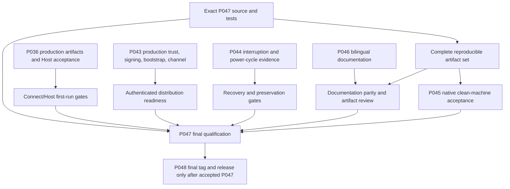

# Prompt047 manifest — final release-candidate validation

## Validation checkpoint — 2026-10-12 01:22 UTC (superseded by the blocked-resume audit below)

**P047 preparation is complete for the currently available validation surface; final release qualification remains BLOCKED.** Main and PR #104 base are `3851ea11927e24255614cfc38adbaccbd345ca03` (tree `7801eb5c0d57a312072440a1f2decb463008b12c`). The product source under test was `d712e84e5bb21b1b2f845352c59ac10f0485c24c` (tree `63ee01be4861a84577331aa0579739df0f0060a7`), the published product head at the validation snapshot. The final P047 closeout commit changes only the report, manifest, and report validator/tests; it does not change the tested product tree. PR #104 remains OPEN / DRAFT / UNMERGED. P045 PR #78 is independently OPEN / DRAFT / UNMERGED at `035497c05c145e5c6129e744f9455937069680f4`.

### Source and hosted-workflow provenance

- Push-event builds below checked out the exact d712 source commit.
- GitHub pull-request workflows report the same d712 branch head but checked out synthetic merge `d331cac35888891a1c16bd8d02649885ade5db1f`. Its tree is identical to d712 (`63ee01be4861a84577331aa0579739df0f0060a7`). PR integration artifacts are recorded separately and are not used as exact d712 push artifact identities.
- The report records all 25 exact-head workflow runs, completed job IDs, current status/conclusion, artifacts, and checkout SHA in `acceptance/p047/release-candidate-validation-v1.json`.

### Exact d712 validation results

| Surface | Workflow / jobs | Result and scope |
| --- | --- | --- |
| Rust/source quality | Exact-source push run `38186860837` completed successfully. Format/strict Clippy `114611010552`, dependency policy `114611010617`, Web `114611010693`, cross-platform checks, Windows/macOS/Ubuntu workspace tests, Linux Qt `114611010661`, and Windows Qt `114611010669` passed. Windows Qt built and reproduced release binaries, built and byte-compared the runtime ZIP, verified QML/PE output, loaded the packaged QML shell, and uploaded artifact `11721608722`. | SOURCE_QUALITY PASS on direct d712 source. Duplicate PR run `38186864914` job `114610958660` was cancelled at its 60-minute limit during runtime ZIP build/audit; its synthetic merge tree equals d712. The incomplete PR event is recorded separately; the direct push run completed all source checks. |
| Windows P025 installer | Exact d712 push run `38186860844`, job `114610942751`, Actions artifact `11720223926`. | PASS for authenticated MSVC linker/runtime, source and payload closure, two-build Setup reproducibility, asInvoker, isolated lifecycle fixtures, disposable standard-user install, desktop QML smoke, client process probe, uninstall/reinstall, preservation, and cleanup. Not Windows 11 interactive P045 acceptance. |
| Linux DEB/RPM | Exact d712 push run `38186860882`: producer/rebuild `114610999770`, Qt-generated-input reproducibility `114610999871`, systemd validation `114610999881`, Ubuntu APT `114619234558`, Fedora 42 userspace DNF `114619234540`. Actions artifact `11721460414`. PR integration run `38186864795` also completed successfully against merge tree d331. | All exact d712 producer, byte-rebuild, package-manager lifecycle, non-root offscreen launch, removal/erase, and preservation jobs passed. APT uses a pinned test digest, localhost TLS, and `--yes`; DNF uses a disposable account with narrow exact-command sudoers. These harnesses do not qualify visible ordinary-user authorization or P045 clean machines. |
| Linux AppImage | Exact d712 push run `38186860799`, job `114610991796`, Actions artifact `11720483620`. | PASS for independent reproduction, AppDir/runtime/QML inspection, executable permissions, AppRun launch, isolated QML smoke, and current-user lifecycle. The type-2 runtime base still comes from a continuous URL without a pinned digest. |
| PostgreSQL 17 | Exact d712 push run `38186860745`, job `114610993271`; PR integration run `38186864935`, job `114610957281`. | PASS for P033 service contract run `38186864877` job `114610955094`, P034 network contract run `38186864907` job `114610955407`, live PG17 schema v8 / 36 migrations and scoped maintenance/lifecycle/recovery tests. This does not provide P036 production dependency identities or a releasable server bundle. |
| P035 first-admin bootstrap | PR integration run `38186864948`, job `114610955441`. | PASS for scoped tests only; not installed Host production acceptance. |
| P036 Host production | Run `38186864905`: contract/source job `114610955230` passed; artifact-identity job `114610955330` failed because `acceptance/p036/production-artifacts.json` is absent. Host/interruption jobs `114610955211`, `114610955233`, and `114610955247` did not run. | BLOCKED on authentic production PG17/server/desktop/managed-edge inventory; no Host journey or synthetic substitute is accepted. |
| Windows native candidate / P045 dependency | P028 push run `38186860789`: candidate build job `114610982746` passed; standard-user job `114618721435` passed disposable-account install/lifecycle and cleanup, then ended `BLOCKED_BY_ENVIRONMENT` after recording unavailable interactive GUI, genuine logon, and named-pipe E2E. Candidate artifact `11720524571`; blocker evidence artifact `11720637759`. | Not P045 evidence. Hosted Windows Server 2025 does not meet the P045 Windows 11 interactive-session/logon/IPC requirements. The product-scoped installer lifecycle is recorded separately from this environment blocker. |
| Linux clean-machine acceptance / P045 dependency | PR run `38186864846`: contract and exact artifact build jobs `114610958087` and `114610958286` passed; native platform matrix `114614554493` and evidence gate `114614554495` were SKIPPED. | No Ubuntu 24.04 or Fedora 42 P045 clean-machine acceptance. |
| Security and resilience | Installer-security run `38186864915`; resilience run `38186864986`; source/fixture validators P043/P044 passed. | PASS for scoped policy, path, journal, interruption-fixture and preservation checks. No production keys were created and no VM hard-power event was simulated or claimed. |

### Exact d712 CI artifact inventory

The following are unsigned **v0.1.0 CI outputs**, not authenticated public releases or a complete v0.2.0 candidate set. Raw hashes and sizes are printed by their producers and reproducibility jobs; raw downloads returned HTTP 403, so P047 could not independently rehash the raw payloads. Action archive digests are recorded separately.

| Artifact | Exact source / producer | Raw producer identity | Actions artifact identity | Status |
| --- | --- | --- | --- | --- |
| Windows Setup | d712 / run `38186860844`, job `114610942751` | `SynveilSetup.exe`, 32,682,984 bytes, SHA-256 `ae064adc722cf1c243d8ccdd8fb7a4c4a4521ac7c58415577daa0c22befab658`; two builds matched. | `11720223926`, 32,555,467 bytes, SHA-256 `4ba9a137f96a17af1cd54bb401e3b3b1d85b112b8b1bfedbc64fa6f8acd3f2d6` | UNVERIFIED raw file; unsigned; P045 native acceptance BLOCKED. |
| Ubuntu DEB | d712 / run `38186860882`, job `114610999770` | `synveil_0.1.0_amd64.deb`, 12,143,612 bytes, SHA-256 `d193d6c0ca1120314b271fe1020ff6ab9a2b5a2b1fc0e4bcf63fb2d0bc6ffd67`; independent rebuild byte-identical (source fingerprint `cf2b7fdf720b5c4a3355ecc2084411e152657aec4bf966fd7979da84c611fd47`, `SOURCE_DATE_EPOCH=1791763688`, 3 source entries). | Shared package artifact `11721460414`, 24,121,640 bytes, SHA-256 `ce0ac12fafa74fb4e9215a37b9850b32d892701c46f9106b0aaa34e6054480a9` | UNVERIFIED raw file; unsigned; P045 native acceptance BLOCKED. |
| Fedora RPM | d712 / run `38186860882`, job `114610999770` | `synveil-0.1.0-1.x86_64.rpm`, 12,155,462 bytes, SHA-256 `36457752816b3f0a73e73979f47eab5be60665ddcff4509adde1964f0343bc92`; independent rebuild byte-identical (source fingerprint `cf2b7fdf720b5c4a3355ecc2084411e152657aec4bf966fd7979da84c611fd47`, `SOURCE_DATE_EPOCH=1791763688`, 3 source entries). | Shared package artifact `11721460414`, 24,121,640 bytes, SHA-256 `ce0ac12fafa74fb4e9215a37b9850b32d892701c46f9106b0aaa34e6054480a9` | UNVERIFIED raw file; unsigned; P045 native acceptance BLOCKED. |
| AppImage | d712 / run `38186860799`, job `114610991796` | `Synveil-0.1.0-x86_64.AppImage`, raw SHA-256 reported as `62fcb3b9bfdaf83995750f140b9ff1025e3d8f594cffa0228fdd3a37e0bfc11b`; raw size was not retained. Independent reproduction passed. | `11720483620`, 48,067,497 bytes, SHA-256 `b169d81ee3bcb7dfafe36685e92b1526494e3f8b8a9ea4da041629724f9c4831` | UNVERIFIED raw file; unsigned; runtime-base digest unpinned; P045 acceptance BLOCKED. |
| Windows P028 candidate (separate from P025 Setup) | d712 / run `38186860789`, build job `114610982746` | `SynveilSetup.exe`, 32,682,985 bytes, SHA-256 `dfc0b0c2c5d60a3ef6b25452942513ba3a5f6681955092dd760ac5d43f0093d6` | Candidate archive `11720524571`, 32,233,887 bytes, SHA-256 `433836dc271d1e976538a52342c46d63f11cb238c94173f9dc9853174726ef2f`; environment-blocker archive `11720637759`, 82,341 bytes, SHA-256 `a5ae1e44f3a7431487bf0478933671c269f96450231f1293c7dfc78cb80e4976` | Separate support candidate; not P045 acceptance. |
| Production server bundle, P036 dependency inventory, release channel metadata, complete v0.2.0 manifest, production signing/trust material | — | No exact production identities | — | MISSING / BLOCKED; not fabricated. |

The Windows Qt native-desktop workflow also uploaded its reproducible runtime ZIP as diagnostic CI artifact `11721608722` (50,794,274-byte Actions archive; SHA-256 `47cb2c0aea7748457887404d97200412cf28759d54477918cfda8b98d868c761`) from exact d712 run `38186860837`, job `114611010669`. It is an unsigned CI test package and is not substituted for the Windows P025 Setup candidate.

### Local and report checks

- PASS: `./scripts/validate-p047-release-validation.sh` — 21 gates and 11 P047 report tests; overall decision remains BLOCKED.
- PASS: `./scripts/validate-docs.sh` — P046 English/Vietnamese parity, links, commands/flags, platform/release wording, P043/P044 doc contracts.
- PASS: `./scripts/validate-install-acceptance.sh` — 11 scenario definitions and 21 contract tests; native execution was not performed locally.
- PASS: `./scripts/validate-release-manifest.sh` (34 tests), `./scripts/validate-release-download.sh` (77 tests), `./scripts/validate-release-channel.sh` (101 tests), `./scripts/validate-linux-quick-install.sh`, P043/P044 validators, Windows installer/source regressions and AppImage validator tests.
- PASS hosted on exact d712: Rust format/strict Clippy, dependency policy, Web, cross-platform checks/workspace tests, Linux and Windows Qt, reproducible Windows runtime ZIP plus packaged-QML smoke, Linux packages/APT/DNF, AppImage, Windows P025 installer lifecycle, PG17 and P035 scoped tests.
- BLOCKED locally: `cargo fmt --all -- --check`, strict Clippy, and Cargo workspace tests because Cargo is unavailable. Exact-source hosted Rust CI run `38186860837` passed those checks. Its duplicate PR integration run `38186864914` was cancelled at the 60-minute cap during the Windows runtime ZIP audit; this does not replace the successful direct push evidence.
- BLOCKED locally: `./scripts/validate-release-artifacts.sh` because `target/packages/SYNVEIL-LINUX-ARTIFACT-MANIFEST.txt` is absent; no local package payload exists.
- PASS: `git diff --check` after report refresh.

### Release blockers and qualification decision

- **P045:** PR #78 remains OPEN / DRAFT / UNMERGED at `035497c05c145e5c6129e744f9455937069680f4`. Genuine Windows 11 GUI/logon/named-pipe acceptance, Ubuntu 24.04 and Fedora 42 clean-machine journeys, exact authenticated candidate binding, data preservation and real hypervisor power-cycle evidence remain unavailable. P047 does not merge or import P045 changes.
- **P036:** `acceptance/p036/production-artifacts.json` is absent. Authentic PostgreSQL 17 and managed-edge identities, a controlled reachable server, installed Host UI, first-admin/login/library/initial sync/recovery/preservation acceptance remain required.
- **Production trust and distribution:** production key custody/signing, independently trusted bootstrap, authenticated stable-channel publication, rollback high-water publication and independent key rotation are absent. P047 created no production keys.
- **Candidate completeness:** current product version remains `0.1.0`; no complete target `0.2.0` artifact set or server bundle exists. Raw CI payload hashes have not been independently rehashed, and the AppImage runtime base digest is unpinned.
- **CI run note:** the duplicate PR-event Rust job was cancelled at the 60-minute cap during Windows runtime ZIP generation; the exact-source push run completed the same ZIP build/rebuild, byte comparison, QML/PE checks, and shell load successfully. The cancellation remains visible in the machine snapshot and is not counted as a pass.
- All required release gates remain fail-closed. The machine report records scoped source/product checks as PASS where completed, but the overall decision remains BLOCKED by the external release requirements above. P047 PR #104 stays draft/unmerged. No P045/P036 gate is waived; P047 does not begin P048 or create `v0.2.0`.

The machine-readable 21-gate inventory, current exact-head workflow/job statuses, source and tree identities, artifact archive/raw producer identities, evidence classes, missing requirements and qualification decisions are in [the P047 validation report](../../acceptance/p047/release-candidate-validation-v1.json). Historical sections below remain bound to their recorded source revisions.

## Historical checkpoint — 2026-10-11 21:37 UTC (superseded)

**P047 preparation continues; release qualification is BLOCKED.** This snapshot is bound to exact source `100f088a8ca65d510f0aa1dd9f8174b722d5a661` (tree `2654c69dbba0f90f05b529b61a5f5febe39a2b4a`). The Windows Qt independent rebuild remains in progress; no final source-quality qualification is claimed.

### Current source and PR state

- Audited main and PR #104 base: `3851ea11927e24255614cfc38adbaccbd345ca03`.
- Branch `release/p047-final-rc-validation` and PR #104 head: `100f088a8ca65d510f0aa1dd9f8174b722d5a661`; PR #104 is OPEN / DRAFT / UNMERGED.
- P045 PR #78 remains OPEN / DRAFT / UNMERGED at `035497c05c145e5c6129e744f9455937069680f4`. No P045 implementation or result has been imported.
- Product version is `0.1.0`. No target `0.2.0` artifact set, production release trust, or tag exists. P047 does not start P048 or create `v0.2.0`.

### Exact-source hosted validation

| Area | Exact workflow and job | Current result | Qualification limit |
| --- | --- | --- | --- |
| Rust and desktop CI | Push run `38174873852` at `100f088`. Format/Clippy `114575044749`, dependency policy `114575044671`, Web `114575044690`, Windows/macOS/Ubuntu checks `114575044777`/`114575044715`/`114575044719`, Windows/macOS/Ubuntu workspace tests `114575044798`/`114575044732`/`114575044751`, and Linux Qt `114575044678` passed. | PASS for listed jobs; Windows Qt job `114575044654` remains in progress at “Rebuild Windows release binaries after clearing release outputs.” | Do not count the `/Brepro` independent Windows release comparison until job `114575044654` completes successfully. |
| Windows installer | Push run `38174873914`, job `114575044368`, source `100f088`. Authenticated linker/runtime, PE closure, two-Setup reproducibility, asInvoker inspection, isolated fixtures, and synthetic standard-user install/lifecycle passed. | PASS for scoped hosted installer/lifecycle. | Artifact `11715688787` is unsigned v0.1.0 CI output. It does not establish P045 Windows 11 interactive GUI, genuine logon, named-pipe IPC, or hard power-cycle acceptance. |
| Linux DEB/RPM | Push run `38174873899`: producer `114575044620`, independent two-tree rebuild `114575044548`, systemd validation `114575044655`, Ubuntu APT lifecycle `114580913922`, Fedora 42 userspace DNF lifecycle `114580913954`. | PASS: production, byte reproducibility, package install, non-root launch, remove/erase, and preservation checks all passed. | Artifacts are unsigned v0.1.0 CI output. Hosted package jobs are scoped evidence, not P045 clean-machine acceptance. |
| Linux AppImage | Push run `38174873864`, job `114575044610`: build, independent reproduction, manifest/AppDir inspection, isolated QML/AppRun smoke, current-user lifecycle, and upload passed. | PASS for the scoped AppImage checks. | Artifact is unsigned v0.1.0 CI output. The type-2 runtime base is fetched from a continuous URL without a recorded pinned digest; P045 acceptance is absent. |
| PostgreSQL 17 | Push run `38174873875`, job `114575044486`. | PASS: PostgreSQL 17.11, schema v8 / 36 migrations, maintenance, backup/recovery, lifecycle, stress, and adversarial suites passed. | Does not establish a production server bundle or P036 Host acceptance. |
| P035 bootstrap | PR run `38174877552`, job `114575055190`. | PASS for scoped first-admin bootstrap tests. | Does not establish installed Host production acceptance. |
| P036 Host production | Run `38174877595`: contract/source job `114575055423` passed; artifact-identity job `114575055495` failed at `test -f acceptance/p036/production-artifacts.json`. Host and interruption jobs `114575055476`, `114575055458`, and `114575055500` remained queued. | BLOCKED by missing production inventory; Host/interruption journeys did not run. | Do not fabricate PostgreSQL 17, managed-edge, desktop, or server production identities. |
| Native acceptance | P028 candidate push run `38174873865`: candidate build passed and synthetic standard-user product checks passed; blocker artifact `11716027634` records GUI/logon/named-pipe surfaces blocked. Linux clean-machine PR run `38174877589` passed artifact build/contracts, but clean-machine matrix and final evidence gate were SKIPPED. | No accepted P045 native result. | P028/PR contract jobs do not substitute for P045. No Windows 11 interactive session, Ubuntu/Fedora clean-machine result, or real power-cycle evidence exists. |

The current 100f API snapshot includes 25 exact-head workflow runs. PR event workflows are distinguished from push-source build evidence in the machine report. The P028 jobs fail after recording unavailable interactive GUI, genuine logon, and named-pipe surfaces; the P036 artifact-identity prerequisite fails because its production inventory is absent. These are explicit environment/dependency blockers, not inferred product passes.

### Rechecked historical CI failures

| Failure | Observed root cause | Correction and exact-source evidence | Remaining limit |
| --- | --- | --- | --- |
| Rust formatting, run `38116522371`, job `114402386308` | `cargo fmt --all -- --check` reported a formatting diff at `crates/client/src/process.rs:502`. The PR run's source head was `190c45a`; its runner checked out synthetic merge `f3598c9`. | `24662a0` corrected formatting without changing behavior. Exact 100f format/Clippy job `114575044749` passed. | This is source-quality evidence only. |
| Windows root-exclusion test, run `38116522371`, job `114402386339` | `path::tests::current_directory_home_and_workspace_roots_are_rejected` failed because the current-directory form and canonical form did not compare as the same protected root on Windows. | `2dad3fb` canonicalizes existing candidate paths; `c744bea` normalizes shared-root exclusions and adds canonical-path assertions. Exact 100f Windows workspace test job `114575044798` passed. Exclusion assertions remain enabled. | The passing workspace test is not native installer acceptance. |
| Windows standard-user child, installer run `38116522415` job `114402385167` and native run `38116522258` job `114406751982` | Both wrappers reported `stage=wait_for_standard_user_test child exit 1`. Bounded artifact `11694492078` (SHA-256 `b56ff55a41330757249008057a0e3ef0346c7bdc879b4e12db633bb547f5e8b9`) recorded `Cannot bind argument to parameter 'Path' because it is an empty string` in `test-windows-per-user-installation.ps1`. | `f1c5493` resolves and validates the standard user's actual profile, profile-scoped AppData and Desktop, and private temporary folder before Setup execution; the account/profile regression suite passed 13 tests. Exact 100f Windows installer job `114575044368` passed the synthetic standard-user lifecycle. | The separate P028 native job remains BLOCKED after product checks because the hosted runner lacks interactive GUI, genuine logon, and named-pipe capabilities. This is not P045 acceptance. |
| Windows Inno uninstaller self-cleanup | Inno can return from its registered uninstaller while its second-phase helper still removes that exact uninstaller file; immediate test cleanup raced this bounded lifecycle. | `71755c5` waits up to 30 seconds for only the registered uninstaller beneath the package root and rejects any other residual files. Exact 100f Windows installer job `114575044368` passed uninstall, preservation, reinstall, and bounded self-cleanup. | The test wait does not relax ownership checks or prove real power-cycle recovery. |
| Ubuntu APT state verification, package run `38116522348`, job `114409718518` | The native DEB transaction completed but quick-install returned `VerificationFailed` (exit 60); the post-install package state did not satisfy the verifier. | `67f9f9c` fixes the DNF local-package argument and permits only the exact root-owned, configured dpkg docs omissions; `f6107b5` requests visible authorization to verify protected payload and keeps denial fail-closed; `fec6f56` authenticates resolved verifier paths. Exact 100f APT job `114580913922` passed install, verified rerun, non-root offscreen launch, removal, and preservation. | The hosted check used an ephemeral self-signed localhost TLS endpoint, a pinned test digest, and `--yes`; it does not test a human-visible authorization prompt or P045 clean-machine journey. |
| Fedora DNF authorization, package run `38116522348`, job `114409718470` | Quick-install returned `AuthorizationFailed` (exit 40) when administrator authorization was not granted. The fail-closed interactive authorization boundary behaved as specified. | The product continues to require explicit authorization and never retries package mutation with implicit privilege. The exact 100f DNF job `114580913954` passed using a disposable test account with a narrowly scoped sudoers rule for the resolved DNF and package-verification commands. | This harness grant is test infrastructure, not a visible user authorization prompt; ordinary-user Fedora clean-machine acceptance remains with P045. |

The APT and DNF hosted runs validate scoped package-manager lifecycle behavior, but neither proves the ordinary user's visible authorization journey: APT uses the noninteractive `--yes` test option, and Fedora injects a disposable account's exact-command sudoers rule. Their release gates remain BLOCKED pending exact authenticated candidate artifacts and accepted P045 native journeys.

### Available CI artifact identities

| Artifact | Exact source | Actions artifact and archive SHA-256 | Raw artifact identity | Status |
| --- | --- | --- | --- | --- |
| Windows Setup — P025 installer workflow | `100f088a8ca65d510f0aa1dd9f8174b722d5a661` / tree `2654c69dbba0f90f05b529b61a5f5febe39a2b4a` | Run `38174873914`, job `114575044368`, artifact `11715688787`, 32,559,127 bytes, `9e0ce264a1d1adf8f5e1e1c99265ad469291bcc8c67a66e2ff8c9d5c77607c0f` | `SynveilSetup.exe`, 32,684,340 bytes, `32997a27ae73081cc924088a0a82a1fe957d255782e6999fc617b11e7ba09536` | AVAILABLE as unsigned v0.1.0 CI output; source-bound setup, repair, upgrade, process-interruption fixture, downgrade, uninstall/reinstall, and preservation checks passed. |
| DEB | `100f088a8ca65d510f0aa1dd9f8174b722d5a661` / tree `2654c69dbba0f90f05b529b61a5f5febe39a2b4a` | Run `38174873899`, artifact `11716495614`, archive 24,120,474 bytes, `2bf600240e42e0c7374b1ff99d1f193ec978e18df7f845721ce1c57430b677d8` | `synveil_0.1.0_amd64.deb`, 12,143,616 bytes, `9bc6c738e0f3068f7b74571e7df322923adf73493c9dd40af6431670d2968b8b` | AVAILABLE as unsigned v0.1.0 CI output; producer, two-tree rebuild, APT install/launch/remove/preservation passed. |
| RPM | `100f088a8ca65d510f0aa1dd9f8174b722d5a661` / tree `2654c69dbba0f90f05b529b61a5f5febe39a2b4a` | Shared artifact `11716495614`, archive digest above | `synveil-0.1.0-1.x86_64.rpm`, 12,155,460 bytes, `ffff06bd28958b398a59a5d16817d7d35f2b16e9758466fa4ade79b929a36550` | AVAILABLE as unsigned v0.1.0 CI output; producer, two-tree rebuild, Fedora 42 userspace DNF install/launch/erase/preservation passed. |
| AppImage | `100f088a8ca65d510f0aa1dd9f8174b722d5a661` / tree `2654c69dbba0f90f05b529b61a5f5febe39a2b4a` | Run `38174873864`, artifact `11715128706`, 48,067,493 bytes, `f86ab5285c5267662c2ab9539fe66a80ef6ad59493decfb7bb97b6151f8d81c8` | `Synveil-0.1.0-x86_64.AppImage`, 48,675,320 bytes, `92e23f5010a3e5e4f542fca84e95ba143d502fa1b7c2c512da6a3722214a731f` | AVAILABLE as unsigned v0.1.0 CI output; downloaded bytes and embedded source manifest were verified. Runtime-base digest is not pinned. |
| Windows P028 candidate — separately identified | Same source/tree as above; separate P028 workflow run `38174873865`, producer `114575044602` | Artifact `11714934875`, ZIP 32,235,234 bytes, `0175c4a1399a9d4562aaf3d1573c4965e73d2a16c71768fc0b01f8894be9c2e7` | `SynveilSetup.exe`, 32,684,325 bytes, `bc64a1ea66f31a5602e8855333a26c67a1e632bf2d87256115f2933f90556dd4` | Kept separate from the P025 installer output: same source but different raw bytes. Each identity is independently reproducible; do not transfer P025 lifecycle evidence to this P028 hash or vice versa. |
| Server bundle, P036 production inventory, channel metadata, v0.2.0 manifest, signing/trust references | — | — | No exact release identities | MISSING / BLOCKED. |

Actions artifacts above are CI outputs, not authenticated public release artifacts. Exact v0.1.0 identities do not constitute a v0.2.0 candidate set. No P045 evidence is inferred from hosted synthetic-user, userspace DNF, or offscreen smoke checks.

### Local and report validation

- PASS: `./scripts/validate-docs.sh` — P046 English/Vietnamese parity, relative links, commands/flags, platform limits, release-status wording, and P043/P044 validators.
- PASS: `./scripts/validate-install-acceptance.sh` — 11 scenario definitions and 21 contract tests; native journeys were not run locally.
- PASS: `./scripts/validate-p047-release-validation.sh` — 21 gates, fail-closed report schema, and 10 report tests; overall decision remains BLOCKED.
- PASS: release manifest (34 tests), download integrity (77 tests), release channel (101 tests), Linux quick-install, P043 security, P044 resilience, Windows installer contract, Windows `/Brepro` flag regression, and 13 Windows standard-user regression tests.
- PASS: Web lint, typecheck, 251 tests / 23 files, and production build; exact-source hosted Web job also passed.
- PASS: downloaded Windows, DEB, RPM, and AppImage bytes/archive hashes were recomputed and matched inventoried identities.
- PASS: `./scripts/validate-appimage-runtime.sh /tmp/Synveil-0.1.0-x86_64.AppImage` — 24 bounded runtime/lifecycle checks against exact-source artifact `11715128706`; raw SHA-256 matched the inventory.
- SKIPPED locally: AppImage GUI smoke because `xvfb-run` is unavailable; exact-source hosted AppImage smoke passed.
- BLOCKED locally: `cargo fmt --all -- --check` and Cargo workspace tests because Cargo is not installed. Exact-source hosted format/Clippy and Linux/macOS/Windows workspace test jobs passed.
- BLOCKED: P045 native clean-machine journeys and P036 production Host journey, for the dependencies stated above.
- PASS: `git diff --check` before final metadata refresh; it will be rerun before publication.

### Release blockers

- P045: genuine Windows 11 interactive GUI/logon/named-pipe IPC; Ubuntu 24.04 and Fedora 42 clean-machine journeys; exact artifact binding; lifecycle/data preservation; and real power-cycle recovery remain unavailable.
- P036: `acceptance/p036/production-artifacts.json` is absent. Real PostgreSQL 17 and managed-edge identities, a controlled reachable server, installed Host UI, bootstrap/login/library/initial sync, and recovery/preservation remain required.
- Production infrastructure: signing/key custody, trusted bootstrap, authenticated release-channel publication, and key-rotation evidence are absent.
- Candidate completeness: current product version is `0.1.0`; no complete target `0.2.0` artifact set or server bundle exists. The AppImage runtime base has no recorded pinned digest.
- Windows C++ reproducibility: the `/Brepro` fix is implemented and its flag regression passes locally; exact-source Windows Qt job `114575044654` is still running. No hosted reproducibility pass is claimed until it finishes.
- PR #104 stays draft/unmerged while required evidence is blocked. P047 does not merge PR #78, begin P048, or create the tag.

The full machine-readable 21-gate inventory, source/artifact bindings, workflow/job evidence, missing requirements, and dependency graph are in [the P047 validation report](../../acceptance/p047/release-candidate-validation-v1.json). Historical defect and audit sections below are retained for their stated source revisions; the current checkpoint above supersedes earlier pending statuses.

## Main-branch audit

The audit was performed against `3851ea11927e24255614cfc38adbaccbd345ca03` and its tree `7801eb5c0d57a312072440a1f2decb463008b12c`.

Main contains the P007–P010 installer engine and journal, P012–P020 Linux package and quick-install producers, P021–P028 Windows installer/runtime source, P029–P035 managed server and first-admin source, P037–P042 Connect/first-library/client UX, P043 security hardening, P044 recovery hardening, and merged P046 bilingual documentation. Their source presence is separate from release qualification. The P045 branch is not part of main. P036's Host handoff remains `IMPLEMENTATION_PENDING` for FIRST-RUN-2 and its production dependency manifest is absent.

The audited source still declares product version `0.1.0`. Any CI outputs are recorded as unsigned CI artifacts for that source revision; no v0.2.0 release-candidate set is present. P047 does not change the product version or create the tag; P048 owns the final v0.2.0 release operation.

The acceptance inventory contains 11 versioned journeys. All 11 declare `IMPLEMENTATION_PENDING`; they are scenario definitions, not recorded product results. P047 does not turn source validators, fixture tests, Xvfb smoke checks, or source inspection into native journey results.

### Unmerged pull-request scope audit

At the audit checkpoint, P045 PR #78 is still open/draft and carries the native matrix that is absent from main. PR #58 and PR #59 are old open/draft server-network reachability branches. Their scope overlaps P034, which is already present on main at commit `2e4809f`; PR #59's head patch has the same stable patch ID as that main commit. PR #58 is an alternate P034 implementation with overlapping files, not a separate release-ready platform journey. Neither branch supplies P036 production identities or Host acceptance. PR #103 was merged to its separate `ios-app` base and is outside the desktop/server mainline P047 candidate scope. PRs #58 and #59 remain open/draft and overlap P034 already present on main. P047 does not import unmerged branch contents.

## Reproduced defects and source corrections

The rows below retain the original failure diagnosis and correction history. Their qualification notes refer to the source/workflow snapshot named in each row and are superseded by the current exact-100f results above and in the machine-readable report.

| Area | Exact observation | P047 correction | Qualification consequence |
| --- | --- | --- | --- |
| AppImage | Main run `38015962187`, job `114106149743`, failed `APPIMAGE-8`: linuxdeploy's Qt hook wrapped the reviewed AppRun. | Remove only the known generated Qt hook, fail on unknown leftover hooks, restore the reviewed AppRun before output, and compare it after output. The validator locks the order. | Requires a fresh AppImage build, byte reproducibility, runtime smoke, and native acceptance. |
| Windows toolchain | Main Windows candidate run `38015962172`, job `114106142192`, selected Git's `/usr/bin/link.exe`. | Both Windows candidate workflows and Windows CI now call one PowerShell selector that authenticates the absolute AMD64 MSVC linker from active `VCToolsInstallDir`. | Cross-compilation and hosted compilation are not Windows clean-machine acceptance. |
| Windows CRT | Main installer run `38015962245`, job `114106184060`, passed linker selection then stopped because `Qt6Core.dll` imported missing `MSVCP140.dll`. On intermediate P047 SHA `80cef30506cee79d8b3d2dd36ceef6d423c581e3`, the initial fixed VC143 directory assumption failed on Visual Studio 18/MSVC 14.51. | The selector now locates exactly one `Microsoft.VC*.CRT` directory under that toolset's version-matched x64 `VCToolsRedistDir`; the package copies only imported Microsoft CRT DLLs, then reruns the closed PE import audit. | Exact-head hosted build must prove the selected directory and package closure. |
| Rust cross-platform fixtures | Main Rust CI `38015962171`: Windows test modules imported Unix APIs; Windows config tests used POSIX `/tmp` roots; macOS IPC fixtures exceeded the Unix socket path limit; Windows named-pipe shutdown lost a listener during cancellation. | Unix-only test modules are gated to Unix, config fixtures use platform absolute roots, Unix socket fixtures use short `/tmp` paths, and named-pipe accept retains the pending listener while `connect()` is cancellable. | Requires Rust workspace, Windows, and macOS hosted reruns; no assertion or synchronization data semantics were weakened. |
| Client schema assertion | Main Rust CI run `38015962171` and PG17 run `38015962181` expected local schema 7 after P041 migration 0008 had set `LOCAL_SCHEMA_VERSION = 8`. | Schema assertions now use the authoritative current constant; the packaging contract pins the current value 8. | P041's accepted migration remains in place; upgrade/data compatibility still needs release artifact evidence. |
| P035 test fixture | Main run `38015962207`, job `114106142150`: the first live bootstrap test passed, then the second invocation reused the closed database and expected a fresh `Open` state. | The second exact integration test now gets a newly created PostgreSQL 17 database; its assertions remain unchanged. | Verified at P047 run `38023996395`, job `114130832163`: both live database invocations passed. This scoped result does not satisfy P036 Host production acceptance. |
| Linux package lint gate | P047 run `38023992747`, job `114130875731`: strict ShellCheck stopped before package production with `SC2034` for the unused bounded CRT-loop counter in `deploy/packages/build-windows.sh`. | The loop uses the intentional `_` placeholder; its four-pass closure bound and import audit remain unchanged. | Fix was verified by strict ShellCheck in run `38024448867`, job `114132185268`. The older `62651f` package run `38025827873` was queued at that snapshot; current producer status is below. |
| DEB/RPM reproducibility | Main run `38015962118` failed independent `synveil-desktop` binary identity. Later failure run `38044691622`, job `114191783408`, diagnosed generated RCC resource references beneath independent target build roots. | Stage RCC inputs under a canonical resource root only in explicit reproducible mode (`8b594de`, `d66caf4`); add default/reproducible mode regression coverage. `e150c84` compares the mode at runtime to remain compatible with Rust 1.99. | Root cause and source correction are identified, but exact e150 independent builds and identical final SHA-256 values are not complete; producer job `114215822528` and reproducibility job `114215822653` are active. |
| Windows PE dependency closure | Source `1fbb961`, installer job `114191780027`, rejected `WINTRUST.dll` imported by `vc_redist.x64.exe`; native candidate job `114191778625` also failed the PE audit. | Add only confirmed inbox `WINTRUST.dll` to the case-insensitive reviewed system-import policy (`a890568`); positive and adversarial tests retain unknown/CRT rejection. | Local PE policy test passes. Exact e150 installer job `114215822797` is building; native candidate job `114215822642` is building. Complete packaged import closure is pending. |
| Windows journal durability | Source `1fbb961`, Rust job `114191795986`: 25 passed, 60 failed at the common journal append/flush fixture boundary with `JournalIoFailed`. | `897adbe` opens a writable handle for `FlushFileBuffers` and preserves propagation of durable flush errors; focused regression coverage is included. | Exact e150 Windows workspace job `114215870978` is queued; the full Windows journal rerun is not yet available. |
| Windows damaged-schema cleanup | Source `1fbb961`, Windows Qt job `114191796101`: 287 passed and `local_migrations::tests::damaged_or_unknown_schema_fails_closed_without_repairing_evidence` failed during fixture cleanup after schema-preservation assertions. | `929236a` aligns fixture SQLite WAL/FULL/busy-timeout options with the production pool and performs deterministic pool shutdown. | Exact e150 Windows test/Qt jobs `114215870978`/`114215870995` are queued. No assertion was suppressed; rerun remains pending. |
| Linux atomic editor save | Source `1fbb961`, Ubuntu Rust CI: `observation::tests::linux_notify_backend_handles_live_rename_move_delete_symlink_and_editor_save` observed `MoveNode` after an atomic replacement. | `d9da46c` classifies a replacement over an already tracked destination and adds a focused regression. | Exact e150 Ubuntu workspace test job `114215871005` is queued; repeated native runner validation is pending. |
| macOS server-config fixtures | Rust tests at source `8ebda62` returned `NeedsRepair(SymlinkOrRedirected)` because temporary roots under `/var` traverse macOS `/var` → `/private/var`. | Canonicalize the temporary fixture root and add a focused no-follow store regression; production path checks remain unchanged. | Fix is at `3bc3b67`; exact e0209ed Rust CI is queued. |
| Windows client-sync test teardown | Windows Rust tests reported nine client-sync failures involving supervisor shutdown, atomic readers, and observable writer release; fixture cleanup could race live readers/tasks and retain file handles. | Drain task/reader ownership, close file-backed state before bounded cleanup, and await cleanup completion; assertions and data-integrity behavior remain intact. | Fix is at `8ebda62`; exact e0209ed Windows Rust tests are queued. |
| Rust signal test-support import | Source `87d232d` imported `crate::test_support` at library scope although the module is compiled only under `cfg(test)`. | Move the import into the test module. | Fixed at `8ebda62`; exact e0209ed Rust CI is queued. |
| Windows P044 interruption fixture | Exact source `3bc3b67`, run `38038619787`, job `114174230412`, stopped while constructing synthetic Setup because strict mode found `$ascii` unset in the fixture branch. | Add an explicit ASCII/UTF-16 private-path scan helper and run it for every compiled Setup; add a source-contract regression. | Fix is at `e0209ed`; exact P044 job `114175106109` is queued. The failed run did not reach process interruption or preservation assertions. |
| PG17 scheduled workflow | Main run `38015962181`, job `114106199419`, failed Prompt89 before later scheduled-maintenance steps: actual schema was 8, stale test expected 7. | The stale schema assertions were corrected without changing migrations or data semantics. | Later scheduled-maintenance checks were skipped in that run; their current outcome requires a fresh exact-head run. |

The Linux reproducibility diagnosis artifact is evidence only: workflow artifact `11656224311`, 891 bytes, SHA-256 `32ca6e551c74e4955d4186d410147a8c6ef9bab3cccca0dd0762fed7e6f71c29`. It contains diagnosis metadata, not release binaries or packages.

### Exact cross-platform failures

Main Rust CI run `38016138153` was not a product-wide pass. Its Windows check job `114106700463` failed compiling Unix-only `os::unix` APIs and `PermissionsExt::from_mode`; Windows test job `114106700561` failed for the same target-specific compile issue. Windows Qt job `114106700545` reported these fixture failures: `config::tests::network_hint_interval_is_bounded`, `config::tests::manifest_rejects_control_bearing_root_values`, `config::tests::parses_only_bounded_non_secret_profile_and_library_references`, `config::tests::pending_library_bindings_are_non_secret_and_bounded`, and `config::tests::rejects_relative_roots_duplicates_and_credentials_as_unknown_keys`. Its sixth failure was `control::tests::platform_native_windows_pipe_command_and_shutdown_parity`, where cancellation dropped the named-pipe listener. macOS job `114106700631` failed `control::tests::active_socket_is_never_replaced_and_stale_socket_is_recovered`, `control::tests::local_server_and_client_share_one_host_control_surface`, and `launch::tests::platform_supervised_stop_requests_canonical_shutdown_over_ipc`; each returned `UnsafeEndpoint`. Ubuntu test job `114106700528` failed `production_packaging_units::package_unit_6_upgrade_preserves_state` because the assertion expected schema 7 while the authoritative P041 schema is 8. P047 changes retained all product assertions and migration/data semantics.

P047 run `38024446185` on source `acfd06f1e834a68e59b2eb7faa94155b083d07e9` reproduced three macOS `UnsafeEndpoint` failures: the fixtures used `/tmp`, whose macOS alias resolves through a symlink, so the secure endpoint validator rejected it. Commits `3e52c01d15ded421791f01eecb1145387a3fd10c` and `381b27f4be27c77d64450f58cea08f63e98ad34b` canonicalize a short macOS `/tmp` root and assert the socket path stays below 100 bytes. The same run's Windows job `114132190544` failed `runtime_server_configuration::tests::advanced_external_config_uses_read_only_shared_authority`, `runtime_server_configuration::tests::explicit_managed_authority_rejects_mixed_operator_environment`, and `runtime_server_configuration::tests::preparing_storage_is_not_runtime_ready` with `InvalidPath`: `LinuxConfigLayout` intentionally parses POSIX path components, while Windows fixture paths contain a drive prefix. P047 now runs these Linux server-store tests on Unix targets; their imports and helper functions are gated together to avoid Windows unused-import warnings, and their assertions continue to execute on Linux and macOS. The older Rust run `38025827860` at source `62651f` was queued; subsequent source corrections and exact e0209ed status are recorded below.

P047 Windows installer run `38024448969`, job `114132184799`, verified the explicit MSVC linker and active CRT selection but failed the closed PE import audit on `UIAutomationCore.DLL`, imported by Qt's `platforms/qwindows.dll`. This is a Windows system DLL provided by the supported OS. P047 moved the system import policy into `deploy/packages/common/windows-pe-import-policy.sh`, added that system DLL to the allowlist, and added a regression check that still rejects the MSVC runtime DLLs and unknown imports from the system allowlist. Final producer verification is recorded only from the exact source-head run.

P047 AppImage run `38024448824`, job `114132184041`, built and inspected its AppDir but its bounded QML smoke then failed because the validator forced `QT_QPA_PLATFORM=offscreen` while the packaged AppDir contained `libqxcb.so` and no offscreen plugin. The built image digest printed in that failed, unpublished workflow was `8a39886bb5dedbcc17c374d329af28b2ab689c4f1b772ba18e2af95cc4a09196`; the run did not upload the image, and no byte size or Actions artifact ID is available. The validator now selects the bundled `xcb` plugin under isolated Xvfb; `tests/appimage/test_validator_smoke.py` locks that selection and the missing-Xvfb failure behavior. This harness correction is not itself evidence that the AppRun clean-machine journey passes.

## Historical exact product-source hosted status — e150 snapshot (superseded)

The current product source is `e150c846695f492aabe5d4c9ae7d836c59ea8a9e` (tree `d4dcfdb8b0f8629fea12dbe1ff625408ea9451ce`). The report/manifest update is metadata-only and does not change compiled product or package inputs. PR-triggered jobs check out GitHub's synthetic merge commit (`1f47cd11e591a47fd620501fb5485582f50dd1d6`) where available; push jobs target the exact e150 source.

At the historical e150 snapshot (`2026-10-10 12:51:48 UTC`), 23 exact-head workflows had 66 queued jobs, 13 in progress, and 6 completed jobs (5 successes, 1 failure). Run-level statuses were 14 queued, 8 in progress, and 1 completed. Completed or active results were:

- P034 network reachability run `38053023533`, job `114215830347`: PASS.
- P036 self-host run `38053023492`: source/contract job `114215830382` passed; `artifact-identity` job `114215830337` failed because `acceptance/p036/production-artifacts.json` is absent. Host and interruption jobs were queued; no Host acceptance ran.
- Connection setup address/ownership job `114215830266` passed; quality and desktop presentation jobs `114215830416`/`114215830434` were active.
- Library setup/root-safety job `114215830317` passed; presentation and documentation jobs `114215830486`/`114215830489` were active. These scoped jobs do not establish the installed first-run journey.
- Linux package systemd validation job `114215822644` passed. DEB/RPM producer job `114215822528` and two-tree reproducibility job `114215822653` were active; no package identity or reproducibility digest was available.
- Windows installer push job `114215822797` and PR job `114215830505`, Windows native candidate job `114215822642`, and AppImage job `114215824572` were active. Their artifact endpoints returned zero uploads.
- Linux clean-machine artifact job `114215833688` was active, with no artifact uploaded. The Windows native PR candidate job `114216728075` was queued.
- Rust CI push run `38053020576` remained queued, including format/Clippy `114215871011`, Windows tests `114215870978`, Ubuntu tests `114215871005`, and native Linux/Windows Qt jobs `114215870813`/`114215870995`. PG17 push job `114215834827` was queued. P035 bootstrap job `114215830407` was active.

The exact e150 producer inventory therefore contains no Windows installer, DEB, RPM, AppImage, or native-acceptance artifact identity. A prior e020 AppImage (`Synveil-0.1.0-x86_64.AppImage`, workflow artifact `11664704777`, payload 48,638,456 bytes, SHA-256 `2887bbf9a392f13f37b21bb0995c527b0ec5c84718613c1f637b25eccd549acd`) is preserved in the machine report as unsigned, unverified CI output for its older source only.

The exact e150 RCC fix has not passed two independent clean builds yet. The earlier source failure reproduced generated resource references under distinct target roots; current e150 build and differential jobs were active. No reproducibility pass or digest is claimed. Local report/source validators pass where tools are available; local Cargo is absent, and local pytest is absent (the AppImage unittest module passed when run directly).

All queued, in-progress, failed, missing, or insufficient evidence remains non-qualifying. The complete run/job matrix, current artifact identities, source revisions, evidence class, and gate-specific decision are in the machine-readable report. P045/P036 and production trust, signing, bootstrap, and authenticated-channel dependencies remain release blockers.

## External dependencies and remaining release gates

P045 must be genuinely accepted and merged, or provide an explicitly supported verified evidence contract, before native Windows 11 interactive GUI/logon/named-pipe, Ubuntu 24.04, Fedora 42, lifecycle/data-preservation, and real power-cycle requirements can be counted.

The P045 handoff remains operationally blocked: registration labels do not prove a usable desktop or hardware power control. Its documented KVM and interactive Windows worker prerequisites, exact candidate transfer, and result-v1 aggregation must be completed by the P045 owner before P047 can import accepted native evidence.

P036 must provide the real `acceptance/p036/production-artifacts.json` with authentic PostgreSQL 17 and managed-edge identities. The installed Host UI must then complete real first-admin bootstrap, normal login, library setup, initial synchronization, recovery, and preservation against a controlled reachable server. The file is absent; P047 will not fabricate it or substitute fixtures.

Production signing keys, trusted bootstrap, authenticated channel publication, and key-rotation evidence remain unavailable. P043 source validators prove verifier policy, not production signing infrastructure. P044 source/fixture checks do not prove real power-cycle recovery.

Platform qualification remains limited to Windows 11, Ubuntu 24.04 x86_64, and Fedora 42 x86_64 candidates until accepted native evidence says otherwise. No Debian derivative, other RPM distribution, or generic Linux support claim is added.

## Dependency graph



P048 prerequisites include every required gate passing at the exact candidate identities, P045 native evidence, P036 live Host evidence, a complete and authenticated artifact set, production trust/signing/channel readiness, documented upgrade/repair/uninstall preservation, power-cycle recovery, and accepted P047 work merged to main. P047 does not perform any P048 action.

## Blocked-resume audit — 2026-10-12 11:01 UTC

The existing P047 and P045 pull requests and their histories were fetched and checked. Main remains `3851ea11927e24255614cfc38adbaccbd345ca03`; PR #104 remains OPEN/DRAFT against `main`, and PR #78 remains OPEN/DRAFT/UNMERGED at `035497c05c145e5c6129e744f9455937069680f4`. At the snapshot, PR #104 head was `1ba1c64e5cf12bf11394169012c4c7bd76b08c85`, still testing product source `d712e84e5bb21b1b2f845352c59ac10f0485c24c`.

GitHub currently reports PR #78 as `mergeable=false`, `mergeable_state=dirty`; its PR API base SHA is `a560a40c8f2fe5b91db27c1b63fa0b0ab87173bc` while the current `main` branch is `3851ea11927e24255614cfc38adbaccbd345ca03`. A local merge preview against current main found one conflict, `scripts/validate-docs.sh`: main requires the `rg` preflight and the P046 bilingual-document validator, while P045 added its matrix validator in that validator slot. The branch was left unchanged. Before accepting P045, resolve this conflict while retaining the `rg` preflight and running both independent validators; rerun source checks on the resulting source.

The last exact-head P045 matrix run is `37970834983` at `035497c05c145e5c6129e744f9455937069680f4`. Its source-gates and artifact producer jobs passed, but the Windows standard-user job failed closed at “Record required unavailable surfaces honestly” because hosted Windows Server 2025 lacks Windows 11 interactive GUI, genuine logon and installed named-pipe E2E. The four Ubuntu 24.04/Fedora 42 guest jobs failed at “Boot the disposable native guest and establish readiness”; both native evidence gates failed. These are environment/acceptance failures, not product PASS evidence. The Windows workflow is hard-coded to `windows-2025`, and its own evidence records that interactive/logon/named-pipe acceptance is unavailable or unwired. The Linux workflow has the reviewed `linux_native_runner` dispatch input, but dispatch remains unauthorized until the labeled isolated KVM worker has been provisioned and verified.

This execution host is Debian 13 x86_64. `/dev/kvm`, `qemu-system-x86_64`, `virsh`, Xvfb/display, Windows 11 interactive session, PowerShell, Cargo and rustc are absent. Docker is not accepted as a substitute for a native VM or hypervisor power-control worker. GitHub runner enumeration returned HTTP 403, so registered runner count is unknown; no claim is made that the repository has zero registered runners. No qualified worker was accessible or verifiable in this execution.

The latest exact-source P036 workflow run `38186864905` at d712 remains queued. Contract/source job `114610955230` passed, artifact-identity job `114610955330` failed because `acceptance/p036/production-artifacts.json` is absent, and the Ubuntu (`114610955211`), Fedora (`114610955247`) and interruption (`114610955233`) self-hosted jobs remain queued. The expected native scripts `scripts/run-p036-native-acceptance.sh` and `scripts/run-p036-power-interruption.sh` are also absent. No installed Host journey or power-interruption acceptance ran.

The requested `acceptance/install-scenarios-v1.json` is absent from both fetched main and P045. The actual 11-scenario inventory is emitted by `python3 scripts/install_acceptance.py inventory`; all 11 definitions still report `IMPLEMENTATION_PENDING`, and zero native journeys are recorded. The P045 static row ledger remains `deploy/acceptance/p045-matrix-v1.json`.

No product code or P045 branch was changed during this resume. No native workflow was dispatched, no new candidate bytes or hashes were created, no production keys were created, no PR was merged, and no release tag was made. The existing source-quality evidence remains bound to d712 and Rust CI run `38186860837`; duplicate PR run `38186864914` remains CANCELLED. The exact d712 Windows/DEB/RPM/AppImage files remain unsigned v0.1.0 CI artifacts, with raw payload identities UNVERIFIED after the prior HTTP 403 downloads. There is no complete authenticated v0.2.0 candidate set, server bundle, production signing/trust bootstrap or authenticated channel. Gate counts remain 21 total: qualification 1 PASS / 20 BLOCKED; actual test inventory 14 PASS / 7 BLOCKED. P048 remains not ready.

Continuation checks passed: `./scripts/validate-p047-release-validation.sh` (21 gates, 14 report tests), `./scripts/validate-docs.sh`, `./scripts/validate-install-acceptance.sh` (11 scenarios, 21 contract tests), the P043 and P044 validators, and `git diff --check`. No new hosted workflow or native acceptance run was started. Local Cargo/rustc and native Windows/KVM/display capabilities are unavailable as recorded above.

### Operator handoff

1. A repository administrator must provision isolated native workers before another acceptance dispatch. For Linux, use the P045 handoff’s ephemeral `self-hosted,linux,x64,synveil-p045-kvm` runner, verify writable `/dev/kvm`, install the documented QEMU/image/SSH tooling, restrict it to disposable guests, and keep production networks and secrets out of untrusted PR jobs. Once the exact reviewed P045 head and authenticated candidate artifacts are ready, use the documented dispatch:

   ```bash
   gh workflow run cross-platform-clean-machine.yml \
     --repo nghianguyen150612/Synveil \
     --ref feat/cross-platform-clean-machine-matrix \
     -f 'linux_native_runner=["self-hosted","linux","x64","synveil-p045-kvm"]'
   ```

2. Before P045 can claim Windows acceptance, provide a disposable Windows 11 VM with an active genuine standard-user desktop session and hypervisor-owned snapshots. The current workflow only targets `windows-2025`; P045 must add a reviewed, isolated route to that Windows 11 session and a driver that observes actual GUI Setup, real logon, installed named-pipe IPC, lifecycle and preservation. The existing hosted Windows result cannot satisfy it.

3. Add the reviewed mutation-boundary power-cycle driver on the hypervisor host. It must observe the product boundary, cut power to the same persistent guest disk without OS shutdown, reboot that disk, run actual recovery/reconciliation and verify preservation. Do not substitute process termination, graceful shutdown, container restart or snapshot rollback.

4. The P036 owner must obtain authentic distributed desktop, server, PostgreSQL 17 and managed-edge bytes and independently verify version, source revision, platform, architecture, SHA-256, provenance and license before creating `acceptance/p036/production-artifacts.json`. The owner must also provide the two currently absent native driver scripts, controlled reachable server, protected test credentials and labeled Ubuntu 24.04/Fedora 42/hypervisor workers. Only then dispatch `server-self-host-acceptance.yml` on the reviewed source and run the actual installed Host bootstrap/login/library/sync/recovery/preservation journey.

5. Release engineering must produce and authenticate the complete v0.2.0 candidate set, independently hash retrieved raw bytes, bind each artifact to its source and producer, pin the AppImage runtime base, and provision production signing custody, trusted bootstrap, rollback protection, key rotation and authenticated channel publication. Current v0.1.0 CI output is not an eligible substitute.

6. After dependencies are accepted, update P045 from current main and resolve `scripts/validate-docs.sh` by retaining the main P046 bilingual validator, P045 matrix validator and `rg` preflight. Rebuild/requalify the exact candidate source, run P045 and P036 evidence on exact identities, append only observed results to the P047 machine report, rerun its validators, and keep PR #104 draft until all 21 gates pass. Do not start P048 or create `v0.2.0` from this blocked checkpoint.

The machine-readable snapshot in `acceptance/p047/release-candidate-validation-v1.json` records these live refs, run/job states, local capabilities, missing files and unchanged qualification counts. It preserves the distinction between failed workflow jobs, blocked acceptance requirements and unknown runner registry state.
