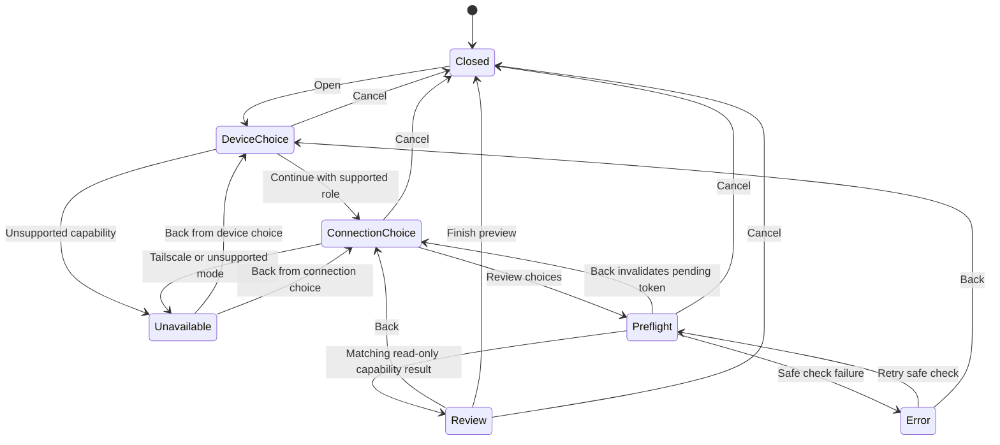

# Synveil v0.3 — P007 Easy Setup Wizard Foundation

**Status: SOURCE IMPLEMENTATION; PREVIEW ONLY.** P007 adds an accessible, three-step Qt/QML surface backed by an ephemeral Rust state machine. It does not install, repair, or configure Synveil. It is not a three-click installer.

The authoritative `Synveil-v0.3-Context-Roadmap-P001-P060.md` was not present in the repository or the available workspace search. This document therefore records the requested provisional, presentation-only scope. P002's architecture proposal informed the boundary but does not replace the missing roadmap or approve the pending maintainer decisions.

## Repository and qualification baseline

- P007 starts from `develop/v0.3` at `953f2e84cef8a1625fef6023715696c590ee2997`.
- P001–P004 are merged through PRs #156, #160, #161, and #162; P001A security/CI repairs are in #157.
- P005A #164 and P005 #163 are merged. P006 #165 is merged at the base SHA.
- Focused P006 run [#40291443669](https://github.com/nghianguyen150612/Synveil/actions/runs/40291443669) completed with failure at **Check formatting** on PR head `9ea0a842b4dc2756c4b29dd2373385bf9556ef04`. P006 HTTP, storage, PostgreSQL 17, retained P005 PostgreSQL, and API Clippy steps were skipped. This run provides no result about those tests and does not qualify P006. No new security or correctness result was produced by that run.
- P006's documented merge exception remains in force. P007 does not mark P006 qualified or rely on its new regression tests as passing evidence.
- P004-D02 (installer privilege), P004-D03 (Tailscale transport), and P004-D11 (installer presentation/effect ownership) remain `RECOMMENDED_PENDING_APPROVAL`.

## Existing owners and capability decisions

The desktop shell is Qt Quick/QML with one CXX-Qt `DesktopUiBridge`. `Main.qml` already owns Welcome, existing Host setup, client connection setup, authentication, and library onboarding. The new preview is an additive Welcome route; the existing routes and `startController()` startup sequence remain intact.

The current Host path is the separate P036/native Host setup. Its supported-platform check is Linux x86-64 running Ubuntu 24.04 or Fedora 42. That is evidence for the existing Host setup path, not evidence that the desktop wizard can install host software. The current desktop Connect path accepts a server address and keeps authentication and device enrollment in its existing flow. Client setup is shown available only when the desktop profile is loadable. “Configure an existing installation” is disabled on first-run Welcome because this screen has no configured installation evidence.

The connection choices reflect existing code owners:

- **Local-only** and **Private LAN** are available as non-mutating preferences when the selected Host or client route exists. Host listener and interface decisions stay with the existing Host flow; the client path still requires an explicit HTTPS server address.
- **Advanced/manual** is available where the current Host or client setup accepts explicit operator configuration.
- **Tailscale** is disabled and labeled planned. There is no Tailscale enrollment/client integration. Selecting or displaying a network path never grants Synveil authentication.

Existing install surfaces remain authoritative for their own scope: Linux DEB/RPM use the native package manager; AppImage integration is current-user; the Windows Inno installer is per-user; Windows portable ZIP is portable. The desktop preview cannot identify which channel produced the current installation, so it offers no target-scope selector and never infers a privilege requirement.

## Three-step flow

1. **This device** — select Host, client, or configure existing. The client path is the visible recommendation when available. Unsupported choices remain visibly disabled and are also rejected by Rust if invoked directly.
2. **Connection** — select local-only, private LAN, or advanced/manual. Tailscale is disabled with a future-capability explanation. These choices are held only in memory; the wizard does not save endpoints or change listeners.
3. **Review** — show the selected role and mode plus allowlisted platform capability evidence. Report installer preflight as **not run**, verified artifact as **unavailable**, plan preview as **unavailable**, target scope as **undetermined**, and privilege as **not assessed**. The view states **Preview only — installation is not started** and points to the existing Host or Connect flow as the safe next action.

There is no Install button. Finishing or cancelling closes the ephemeral preview. No selection in this wizard dispatches existing Host or client setup actions.

## Rust state machine

Rust owns typed selections, transition validation, process state, selection generation, and the bounded capability snapshot. QML receives a redacted `QVariant` view containing fixed codes and booleans. Process state is separate from the visual step index.

Duplicate Continue requests cannot start another probe while the state is `Preflight`. Role or connection changes increment the generation, clear the prior report, and expose an invalidated-preview message. A completion is accepted only for the active generation. Back and cancel invalidate an in-flight token. Retry is limited to the safe read-only check failure. Invalid strings are parsed into closed enums and are never retained.

The current asynchronous probe only maps known capabilities away from the GUI thread. It is not an installer preflight and returns no `PreflightFinding` because no platform preflight adapter is connected. When a future owner supplies findings, the presentation mapping retains only whether a blocking finding exists; it drops finding IDs, capability strings, and evidence.

## UI/engine trust boundary and preview limits

`synveil-install-engine` defines `InstallationRequest`, `InstallationPlan`, effects, privilege requirements, findings, error categories, validation, execution, and journal behavior. Its engine validates a supplied plan and executes through an adapter; no desktop read-only plan builder or channel-specific installer adapter exists. No verified artifact is supplied to the desktop wizard.

P007 deliberately does not create an `InstallationRequest`, `InstallationPlan`, plan fingerprint, `InstallationEffect`, journal record, or artifact verification claim. It uses `TargetScope` only to make the current inability to select a scope explicit. Every target scope is unavailable through this preview. It does not serialize a plan and does not ask QML to authorize an effect. Future execution must revalidate the authoritative plan and fingerprint through the existing engine and platform owners.

The bounded UI state contains role/mode codes, platform code, capability booleans, preview availability booleans, and fixed error codes. It contains no credentials, raw paths, endpoint values, shell command, environment variable, object key, artifact trust claim, or raw process diagnostic.

## Error and unavailable states

- **Unsupported platform / missing capability** — shown in the relevant choice and rejected in the Rust state machine.
- **Tailscale planned** — explicitly unavailable; no enrollment or connection attempt occurs.
- **Invalid selection / invalid transition** — fixed, bounded error copy; raw input is discarded.
- **Safe preview check failure** — offers retry only for this no-effect check; expandable details remain fixed and omit stderr/secrets.
- **Preflight blocked** — the mapper can show a bounded blocked indicator if a future engine owner supplies a real finding. P007's current probe has no findings because no installer preflight runs.
- **Verified artifact unavailable / plan preview unavailable / privilege not assessed / target scope undetermined** — displayed distinctly in Review.
- **Outcome unknown** — cannot occur in P007 because the wizard starts no effect. Future effect recovery must use the engine's reconciliation state and must not retry an ambiguous effect.

Changing a security-relevant choice invalidates the displayed report. No authentication failure is mapped to a connection error because the wizard performs no authentication.

## No-effect boundary and compatibility

The wizard component calls only its typed wizard bridge slots. The Rust wizard module has no installation adapter, engine execution, privilege, persistence, network, or journal handle. The worker handles bounded in-memory capability values. The existing Host, Connect, profile, sign-in, device enrollment, and library setup owners remain unchanged and reachable from Welcome or the main desktop.

Focused Rust coverage checks supported and unsupported paths, navigation, role/mode invalidation, scope refusal, absent artifact and plan, blocking-finding redaction, duplicate clicks, cancel/stale-result handling, retry/re-entry, invalid input, no-effect boundary, and startup-route compatibility. `scripts/test-desktop-ui.sh` now lint-checks both QML components and retains the existing offscreen Main window smoke path.

## P008 handoff and prerequisites

P008 must first provide an approved, read-only platform preflight/plan producer through the existing engine boundary. It must bind verified artifact evidence and actual target-scope capability, map real engine findings through a bounded DTO, and test that preview inputs match the engine's revalidated plan. It must preserve the existing Linux package manager, AppImage, Windows per-user/portable, Host, and client owners.

Any later effect path requires the pending P004-D02/D11 decisions, independently approved platform authorization, signed/verified artifacts and downgrade policy, immutable plan/fingerprint revalidation, journal/reconciliation/recovery behavior, and native Linux/Windows acceptance. Tailscale requires its separate pending P004-D03 decision and explicit transport adapter/security tests. P008 has not been started by this change.

## Remaining maintainer decisions

- The original P001–P060 roadmap remains unavailable; this scope is provisional.
- P004-D02, D03, and D11 remain pending and are not accepted by this implementation.
- No current policy selects a cross-platform install target or changes package/platform scope.
- P006's focused security qualification remains open until formatting is repaired and its skipped tests run successfully on a reviewed exact head.
