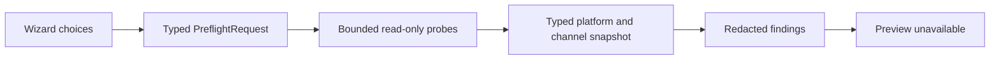

# P008 Read-only Preflight and Plan Preview

**Status: source implementation complete; preview remains unavailable.** P008 is a read-only extension to the P007 wizard. It does not install, repair, configure, or remove Synveil. Local native desktop qualification is blocked by missing DBus development files and Qt 6; hosted P008 checks are pending.

## Scope and branch dependency

- P008 starts at P007 head `59b412f628c63423eb894d9b505d4d5cdda2d8b5` on `feat/v03-p007-installer-wizard-foundation`.
- P007 PR #166 is still open and in draft. P008 is therefore stacked on that branch and must remain a draft until P007 is integrated.
- P006 PR #165 is merged at `953f2e84cef8a1625fef6023715696c590ee2997`. Its formatting repair is isolated in open draft PR #167; P008 does not include that repair.
- `Synveil-v0.3-Context-Roadmap-P001-P060.md` is absent from the checked-in tree and GitHub code search. P008 scope is provisional and is reconciled only with the existing P004 contracts.

The P007 `E0382` bridge reborrow fix is present at the P007 head. P007's exact-head Linux AppImage workflow (#40319985219) completed its native build and packaged QML smoke successfully, and the Windows Qt 6 native UI job in Rust CI (#40319985311) built the shell and packaged QML successfully. The separate Linux Qt UI job stopped at workspace formatting before its test/build commands. P007 is not integrated, and its Windows acceptance workflow (#40319985300) failed after standard-user product acceptance at the required unavailable-surface evidence step.

## Inspection boundary

`PreflightRequest` contains only the wizard generation, role, connection preference, selected channel, and existing profile/installation availability booleans. It accepts no path, digest, signature, publisher identity, credential, or claimed verification status.

`PreflightBinding` keeps that request together with the platform evidence, per-channel evidence, redacted Private LAN candidate count, the scope derived from the selected channel, and an optional artifact identity. P008 always leaves artifact identity absent. The binding rejects a result whose selection, platform, channel set, target scope, or artifact state does not match its request. Results from older generations are ignored; an inconsistent result for the current generation becomes a bounded safe-check error. Every later action would have to inspect and validate again.

The inspector does not call `InstallationAdapter::preflight`, construct an `InstallationRequest` or `InstallationPlan`, call `InstallerEngine::validate`, call `InstallerEngine::execute`, or access the installer journal. No authoritative channel-specific plan builder currently exists. The reusable `PlanPreview` contract retains operation order, touched and preserved resource classes, privilege, reversibility, verification, findings, confirmation prerequisites, and validity for a future engine-owned mapper. It contains no fabricated effects or plan fingerprint.

The current outcome is always:

> Plan preview unavailable — verified artifact evidence required

This remains true even when a package manager or installation marker is observed. P008 does not treat a local digest, package-manager ownership, registry entry, AppImage environment marker, or adjacent manifest as publisher verification.

## Read-only probes and support evidence

| Surface | Evidence source and bound | Result exposed to QML |
|---|---|---|
| Linux OS | Read at most 8 KiB of `/etc/os-release`; parse bounded `ID` and numeric `VERSION_ID`; map distribution IDs to a short allowlist; use the Rust target architecture. | Allowlisted distribution name, numeric version, architecture, managed Host support boolean. No raw file contents or paths. |
| Managed Host | Existing support contract is Linux x86-64 Ubuntu 24.04 or Fedora 42. Host preflight also checks fixed dependency paths for `pkexec`, `systemctl`, and `ip`; it does not execute them. | Blocking unsupported-platform/version or missing-dependency findings. |
| Linux DEB | Requires the Debian-family distribution evidence, x86-64 release architecture, and fixed `/usr/bin/dpkg-query` plus `/usr/bin/apt-get` paths. A bounded `dpkg-query -S <current executable>` query can identify an exact `synveil` package owner. | `NativePackage` scope; missing artifact, partial package ownership evidence, unsupported, or uncertain state. |
| Linux RPM | Requires Fedora 42 x86-64 plus fixed `/usr/bin/rpm` and `/usr/bin/dnf` paths. A bounded `rpm -qf` query can identify the exact `synveil` package owner. | `NativePackage` scope; missing artifact, partial package ownership evidence, unsupported, or uncertain state. |
| Linux AppImage | Linux x86-64 channel. A bounded marker check reads only whether `APPIMAGE` names a regular file; a marker never proves artifact identity or publisher trust. | `PortableUser` scope; no artifact, locally supplied unverified artifact, or uncertain state. |
| Windows per-user Setup | x86-64 only. Fixed `reg.exe query` of the existing HKCU uninstall key and `SynveilManifestSha256` value. | `CurrentUser` scope; missing artifact, unknown installed identity, or uncertain registry evidence. No UAC or SCM call. |
| Windows portable | x86-64 only. Read at most the first 128 bytes of the fixed sibling `SYNVEIL-MANIFEST.txt` and check its header. | `PortableUser` scope; no artifact, locally supplied unverified artifact, or uncertain file evidence. No path or manifest contents reach QML. |
| Existing installation | Linux checks only the current executable's package owner and AppImage marker. Windows checks only the current-user Setup marker and current executable's sibling portable marker. These probes do not search the whole filesystem. | Explicitly uncertain ownership where absence or identity cannot be established. No “not installed” claim is made from a failed query. |
| Private LAN | Only for Host + Private LAN, reuse `synveil-server-host`'s existing fixed `/usr/bin/ip` JSON address/default-route probes (each has the existing 10-second bound). Expose only a candidate count capped at 8. | No interface name, address, route, or command output. Multiple candidates block automatic choice. For Client, no local interface probe runs; remote endpoint identity remains unverified. |

The inspector subprocess helper uses fixed executable paths, fixed arguments, no shell, cleared environment (only `SystemRoot` is restored for Windows `reg.exe`), no stdin, discarded stderr, a 700 ms timeout, and a 1 KiB stdout cap. Process start, timeout, parse, and ownership failures remain unknown rather than being converted into success. Package-manager presence is based on fixed path checks; it does not run package installation commands.

### Channel and scope limits

- Linux native package formats, AppImage, Windows per-user Setup, and Windows portable are distinct choices.
- DEB/RPM package scope is `NativePackage`; AppImage and Windows portable scope is `PortableUser`; Windows Setup scope is `CurrentUser`.
- No system scope is inferred from process UID or administrator membership. P008 never queries privilege state.
- Existing installation management is not treated as a supported installation channel when ownership is uncertain.
- A channel may be supported while its artifact is missing. Channel evidence does not make an installation plan available.
- The local development host inspected for this record is Debian 13 x86-64. It has DEB tools and the `systemctl`/`ip` dependency paths, lacks `/usr/bin/pkexec`, has no RPM toolchain or verified active AppImage marker, and is outside managed Host OS support. Runtime wizard results are still bound to the actual host where the app runs.

## Connection and wizard behavior

The three P007 pages remain:

1. **This Device** — show the detected platform and evidence-backed role availability. Client availability still depends on the existing desktop profile; managed Host availability follows the existing OS matrix.
2. **Connection** — offer Local-only, Private LAN, and Advanced/manual as in-memory preferences. Tailscale stays disabled. Host Private LAN inspection reports only candidate count; it does not change listeners. Client mode does not infer an endpoint or identity from local interfaces.
3. **Review** — show platform, capability findings, channel status, artifact evidence class, scope evidence, and the exact unavailable-plan message. Incomplete OS evidence is stated explicitly. No Install, Apply, Repair, or Configure action is available.

The UI preserves **“Preview only — installation is not started.”** Changing role, connection, channel, or an artifact invalidates prior evidence. Back and Cancel invalidate pending work. Repeated Continue while inspection is active does not queue another inspection. Tailscale does not enroll or connect.

## Bounded failure mapping

| Condition | Presentation behavior |
|---|---|
| Unsupported platform or managed Host OS version | Typed blocking finding; the Host role remains unavailable outside its support matrix. |
| Missing Host dependency or package manager | Typed blocking finding with a fixed dependency label; no helper is launched. |
| Ambiguous installation channel | Typed blocking finding; no channel is selected automatically. |
| Existing installation ownership uncertain | Typed blocking finding; no existing installation is reported as owned. |
| Artifact missing or verification incomplete | Typed finding and the verified-artifact-required plan result. |
| No plan builder or invalid plan | The plan contract supports unavailable/invalid outcomes; no plan is constructed in P008, so invalid-plan validation is not exercised. |
| Inspection failure | Fixed safe error; retry is limited to the read-only check. |
| Cancelled inspection | Back or Cancel increments the generation and drops the pending result. No inspection result is shown. |
| Stale completion | Old-generation completion is ignored. A binding mismatch on the current generation becomes a safe-check error. |
| Insufficient evidence | Blocking typed finding; Review states evidence is incomplete and plan preview unavailable. |

QML receives fixed codes, allowlisted platform text, short channel labels, booleans, and redacted findings. It receives no filesystem paths, environment values, registry contents, package-query output, interfaces, addresses, or credentials.

## Security tests and evidence boundaries

Focused tests cover exact package-owner parsing, no artifact evidence in request input, unavailable preview without evidence, no inferred system scope, binding consistency, Tailscale unavailability, no raw paths in QML summaries, generation fencing, role/connection/channel/artifact invalidation, cancellation, duplicate clicks, safe retry, and existing onboarding routes. Source-boundary tests verify the inspector and wizard bridge do not call engine execution, adapter preflight, or the journal and that QML has no installation action.

These tests establish code-path structure and redaction; they do not replace native Linux/Windows builds or QML smoke tests. No journal or installation effect can be created through the P008 preflight path because no journal or effect API is reachable from it.

## P004 gates and P009 prerequisites

P004-D11 (desktop/platform presentation versus install-engine-owned plans/effects/recovery) remains pending approval. P004-D14 (publisher signing, revocation, downgrade policy, provenance, and reproducible release evidence) remains pending approval. P008 does not approve either trust decision.

Before any later installation action, the owning teams must provide approved channel-specific artifact acquisition and verification, a platform-owned authoritative plan builder, `InstallerEngine::validate` integration, safe plan-to-UI mapping, fresh reinspection and validation, independently approved OS authorization, journal/reconciliation/recovery tests, and native Linux/Windows acceptance. P007 must be merged before P008 is integrated. P009 is not started by this change.

## Validation record

The exact P008 Rust tests, desktop Clippy, QML smoke, documentation validation, and hosted Linux/Windows checks are recorded in [`PROMPT008_MANIFEST.md`](../manifests/PROMPT008_MANIFEST.md). Local full-workspace formatting remains blocked only by the inherited P006 formatting drift in `crates/api/src/tests.rs`; P008 does not edit that file.
