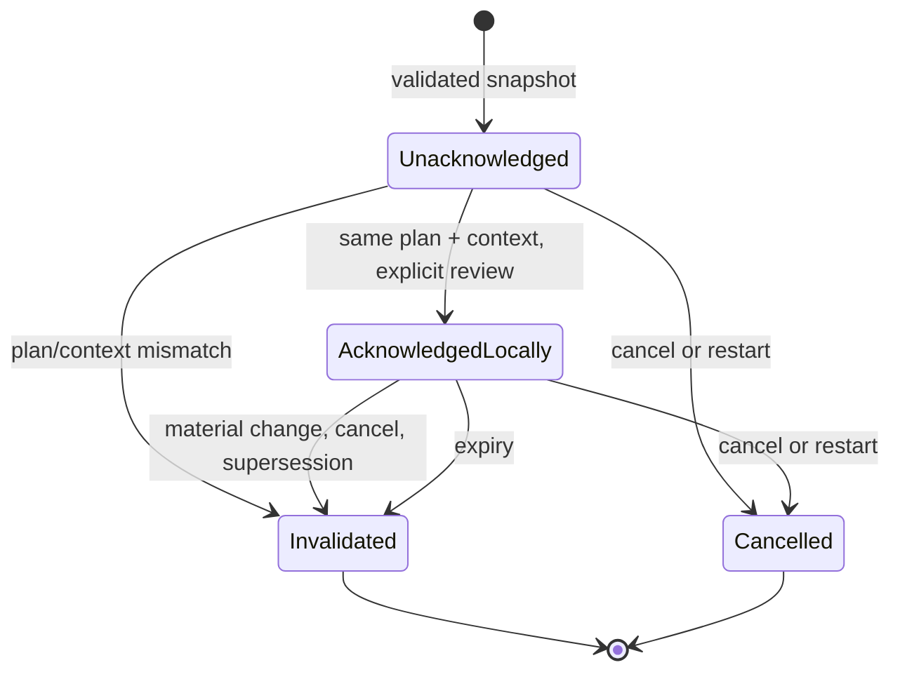

# P009 Plan Confirmation Security Contract

**Status: provisional, non-effectful safety-contract increment.** P009 adds an engine-owned plan-review model and a disabled acknowledgement presentation. It does not create or acquire an installation plan in production. The P008 plan preview remains unavailable because there is no trusted acquisition-to-authoritative-plan path.

## Baseline and scope

- Repository: `https://github.com/nghianguyen150612/Synveil`
- Base branch: `develop/v0.3`
- Actual starting SHA: `a840af012e8510ae0d8ac454bd60b769029f3aaa`
- P009 source implementation commits: `7604d49154b7440c29fe7231af8fa55d86591f73` and `09a8352563c672ecb9b03ff777f0c53bc40585fd` (latest source head).
- Draft PR: [#169](https://github.com/nghianguyen150612/Synveil/pull/169), targeting `develop/v0.3`; its initial source head is `7604d49154b7440c29fe7231af8fa55d86591f73`. The final PR head also includes this documentation closeout commit and is recorded in the final engineering report.
- This is the exact expected P008 merge head. P007 #166 is integrated at `84ee556c8619af0a95b92fb031956e3a46660984`, and P008 #168 at the starting SHA.
- The authoritative `Synveil-v0.3-Context-Roadmap-P001-P060.md` was not found in the checked-in repository or GitHub code search. P009 scope is provisional and reconciles with the checked-in P002/P003/P004 contracts.
- P004-D02 (installer privilege), D03 (optional Tailscale), D11 (presentation/effect ownership), and D14 (publisher trust and downgrade policy) remain `RECOMMENDED_PENDING_APPROVAL`.

P009 calls the existing `InstallerEngine::validate(&request, &plan)` before creating a snapshot. It does not duplicate validation rules or access the execution adapter or journal. Snapshot construction remains crate-private while no approved production plan source exists. Unit tests use synthetic plans only. The desktop has no production fallback and reports the same P008 evidence-required reason.

## Trust and authorization model

The five gates remain distinct:

1. **User review:** an in-memory acknowledgement records only that the user reviewed a specific snapshot.
2. **Plan integrity:** the engine validates the request and plan, then binds the review to a deterministic fingerprint and context generation.
3. **Artifact trust:** the snapshot carries artifact classification and identity evidence. A digest is integrity evidence, not publisher authentication. P004-D14 and provenance ownership remain pending.
4. **Native OS authorization:** unavailable and independent. P009 does not query root/admin state or request UAC, Polkit, sudo, SCM, or helper authorization.
5. **Effect lifecycle and recovery:** not implemented by P009. No execution, journal, reconciliation, or compensation API is reached.

**Acknowledgement is not OS authorization.** A fingerprint is a change-detection commitment, not a signature, credential, bearer token, or execution capability. There is no `confirmed: bool` serving as the authorization model.

## Contract and canonical fingerprint

`PlanReviewSnapshot`, `PlanReviewFingerprint`, `PlanReviewStatus`, `ConfirmationSession`, `ConfirmationAcknowledgement`, `ConfirmationInvalidationReason`, and typed readiness results live in `synveil-install-engine`.

Review schema v1 is encoded as a fixed-order Rust struct serialized with `serde_json::to_vec`. Struct members are ordered in source; `InstallationRequest::user_choices` is a `BTreeMap`; ordered effects and vector fields retain their declared order. The SHA-256 preimage is:

```text
ASCII("SYNVEIL-INSTALLER-PLAN-REVIEW\0")
|| review_schema_version as u32 little-endian
|| canonical_json_length as u64 little-endian
|| canonical_json_bytes
```

The document binds review and engine schema versions; intent; plan ID and target scope; role, connection mode, platform, architecture, channel, capability generation, platform policy ID and required policy IDs; user choices; artifact evidence classification and identity; ordered effects, their owner/resource, privilege, preconditions, verification, retry/reconciliation policy, reversibility and preservation constraints; plan preservation set and completion verification; and material preflight finding codes/severities/blocking state. The existing engine validator rejects unknown engine schema versions; the review constructor rejects unknown review schema versions.

Artifact local paths are omitted from canonical data: both `verified_local_path` and locally supplied artifact paths are private host data, not review identifiers. Verified artifact identity, type, version, source commit, artifact and manifest digests, and authentication method remain bound. Preflight redacted evidence text is omitted; stable finding code, severity, and blocking state are bound. QML receives neither full plan serialization nor raw paths or credentials. Effect contract fields are symbolic plan data and must not contain credentials, private paths, or command text.

The displayed fingerprint summary is only a short digest prefix. It is not a trust claim. A changed effect order, artifact identity, target scope, privilege, preservation rule, material finding, capability generation, or policy ID changes the fingerprint.

## State and freshness



Acknowledgement compares schema, generation, plan ID, fingerprint, engine revalidation, and review completeness. A repeated click is idempotent and keeps the same ephemeral record and expiry. An expired record is cleared and invalidated. An older asynchronous completion is rejected after generation change; it cannot reopen an invalidated session. Cancel and restart discard the acknowledgement. The state is not serialized, so process restart cannot restore it.

The invalidation enum names changes to device role, connection mode, installation channel, target scope, artifact evidence, planned effects, privilege classification, material preflight findings, stale platform capability evidence, wizard cancel/restart, newer plan, policy version, and confirmation expiry. Callers must invalidate and rebuild on these events; reusing an acknowledgement with a different snapshot fails closed.

## Readiness and UI mapping

Readiness returns a review classification separately from execution blockers. `ReadyForReview` means a validated, complete, non-stale plan can be shown. Execution still includes `ExecutionNotImplemented`; publisher policy, privilege policy, native authorization, and recovery qualification remain separate blockers. Process privilege, a click, a local file, a checksum, or network reachability cannot satisfy those gates.

The P008 controller still has no trusted artifact or authoritative plan builder. Its third page maps typed `PlanReviewStatus` outcomes through the Rust view/Qt bridge and shows role, selected channel, platform/capability evidence, artifact evidence, scope, and findings; plan operations, preservation, privilege, and recovery details remain unavailable with the explicit reason. A preview DTO, even one marked valid, is not an engine snapshot and cannot enable acknowledgement. The acknowledgement control stays disabled, and its accessible description states the reason. No fingerprint is invented for the unavailable plan. The page retains **“Preview only — installation is not started.”** No Install, Apply, Repair, Upgrade, listener, credential, or privilege operation is dispatched.

Host and Connect onboarding routes stay in their existing owners. Tailscale remains unavailable without its integration approval.

## Security tests and no-effect boundary

Install-engine tests exercise deterministic snapshots, ordered-effect changes, artifact identity, scope, privilege, preservation, policy/context changes, unknown schemas, invalid plans, local/unverified artifact rejection, stale acknowledgement rejection, duplicate acknowledgement, expiry, foreign plan identity, cancellation, restart, and stale asynchronous completion. Desktop source tests assert the review control is disabled for the P008 outcome, reason text is present, existing Host/Connect routes remain, and no install action or arbitrary shell/privileged call is exposed in the wizard QML.

The review module contains no installation adapter or journal call. The wizard controller still does not construct installation plans, call `InstallerEngine::execute`, alter network listeners, or contact a native authorization helper. These are source and unit-test boundaries; they do not constitute native OS effect qualification.

## Prior qualification and unresolved gates

- P006 #165 was merged with historical failing checks after an explicit integration exception. Its formatting-only repair #167 was merged at `f768474a9fea680b6020f2df10df07a2cf8ea6f2`; the focused P006 authorization workflow #40320179191 and PostgreSQL 17 scheduled-maintenance run #40320179564 completed successfully on that repair head. P006 still lacks the fully joined PostgreSQL plus ObjectStore owner-to-byte test identified in its manifest. The historical exception is not release qualification.
- P007 #166 and P008 #168 were merged under explicit CI/review exceptions. Native Linux/Windows Qt acceptance, post-merge CI, and P008 acceptance remain subject to their exact-head workflow states recorded in `PROMPT009_MANIFEST.md`; merge does not mean qualification.
- P002 decisions remain proposed. P004-D02, D03, D11, and D14 remain pending and are not approved by this document.
- No active critical authorization defect was found in this scoped review-contract path. This is not a broad security audit. Effectful work remains blocked on the named policy decisions and approved provenance/privilege/recovery owners.

## P010 handoff

P010 may begin only after review of this contract and approval of the applicable P004 decisions. Before any production acknowledgement is shown, an approved authoritative plan source must provide real channel-specific plans and independently established artifact provenance. The owning platform teams must then define native authorization, recovery, and exact effect ownership, connect the real snapshot to the desktop DTO without serializing secrets, and qualify Linux/Windows Qt builds and acceptance. P009 does not start P010 or authorize execution.
