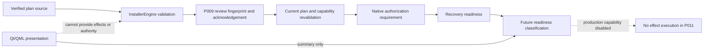
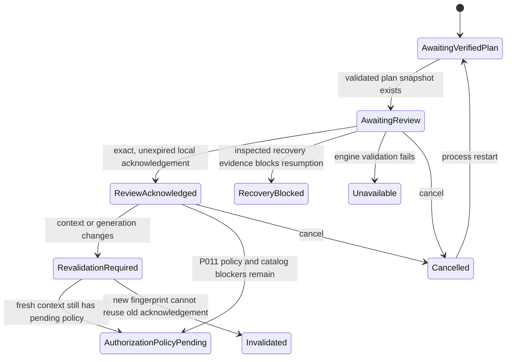

# P011 — Native authorization and execution safety gates

**Status: provisional, side-effect-free contract increment. Production installer
readiness remains blocked.** The authoritative v0.3 P001–P060 roadmap was not
present in the verified repository, so P011 retains the provisional scope from
PROMPT011.

## Purpose and boundary

P011 connects the existing P009 review snapshot and P010 artifact-plan boundary
to a typed readiness report. It does not add an installation route. Production
execution is explicitly disabled, and the production Wizard has no call to
`InstallerEngine::execute`, `InstallationAdapter::apply_effect`, or
`InstallationJournal::open`.

The present P010 source does not provide verified production artifact bytes,
an approved effect catalog, an approved production publisher root, a qualified
recovery policy, or an approved native authorization implementation. The
engine therefore reports typed blockers for every production channel. A
locally constructed `VerifiedReleaseArtifact`, review fingerprint, user
acknowledgement, device role, Synveil session, UID 0, or Windows administrator
membership cannot clear those blockers.

## Rust contracts

`crates/install-engine/src/execution_gate.rs` defines:

- `ExecutionGateInput` and `ExecutionReadinessReport` for a side-effect-free
  assessment using the existing `InstallerEngine::validate` contract.
- `ExecutionGateStatus` and `ExecutionBlocker` for independent plan, review,
  freshness, artifact, policy, authorization, recovery, and production-disable
  states.
- `EffectAuthorizationRequirement`, `AuthorizationRequirementCategory`,
  `NativeAuthorizationAvailability`, and `AuthorizationActor` for operation-
  specific authorization requirements.
- `EffectId`, `EffectCatalogEntry`, and `validate_effect_catalog` for a closed
  set of typed operation identities and pure catalog comparison. The validator
  checks channel, adapter, resource owner/class, scope, phase, preconditions,
  privilege, mutation kind, verification, reconciliation, retry, reversibility,
  inverse, and preservation constraints. No caller-supplied catalog can approve
  production execution.
- `RecoveryReadiness`, `JournalEvidence`, and
  `classify_recovery_readiness` for pure classification of already-inspected
  records. It never opens or creates a journal.
- `ExecutionGateStateMachine` for ephemeral readiness transitions and
  generation-bound asynchronous revalidation. It has no execution method.

The report always contains `ProductionExecutionCapabilityDisabled`,
`LastUseVerificationUnavailable`, pending required policy approvals, and the
missing approved-catalog/native-authorization blockers. The report is a future
readiness classification, not a capability to execute.

## Native authorization ownership

| Operation class | Required owner | P011 category | P011 availability |
|---|---|---|---|
| Ubuntu DEB / Fedora RPM package transaction | The matching native package manager | `NativePackageManagerAuthorization` | Contract only; package-manager authority is not implemented by the Wizard |
| Linux AppImage integration | Current-user integration adapter | `CurrentUserOperation` | Contract only; no operation is requested |
| Managed Linux Host action | Existing bounded Host helper, for a typed scoped operation | `ScopedElevatedSystemOperation` | Policy unavailable; P011 adds no elevation route |
| Arbitrary Linux system operation | No approved owner | `UnsupportedAuthorization` | Unsupported |
| Windows per-user Setup | Existing current-user Setup scope | `CurrentUserOperation` | Contract only; no UAC prompt is launched |
| Windows system-scope operation | No approved P011 owner | `ScopedElevatedSystemOperation` | Unavailable |

The contract has no generic “root/admin” authority input. Native package-manager
ownership, current-user integration, bounded Host-helper actions, and arbitrary
system operations remain distinct. A denied or cancelled native authorization
is classified with no weaker-scope fallback. Any later OS interaction must be
implemented as a separately approved milestone.

## Closed effect catalog

`EffectId` recognizes only the typed P011 operation identifiers. Unknown IDs
fail closed. Catalog comparison binds each plan effect to its channel, owning
adapter, resource class, scope, preconditions, privilege, verification,
reconciliation, retry, reversibility, inverse, and preservation obligations.
The supported contract pairs are:

| Effect ID | Plan channel IDs | Target scope | Required owner |
|---|---|---|---|
| `package.payload.install` | DEB, RPM, AppImage, Windows Setup, Windows portable, or existing-installation channels | The channel's declared package/user scope | Installer engine, package-owned resource |
| `native.deb.package.transaction` | `ubuntu_deb`, `existing_installation`, `existing_installation_maintenance` | Native package | Ubuntu DEB package manager |
| `native.rpm.package.transaction` | `fedora_rpm`, `existing_installation`, `existing_installation_maintenance` | Native package | Fedora RPM package manager |
| `appimage.current-user.integration` | `linux_appimage`, `existing_installation`, `existing_installation_maintenance` | Portable user | Existing AppImage integration adapter |
| `windows.per-user.setup` | `windows_per_user_setup`, `existing_installation`, `existing_installation_maintenance` | Current user | Existing Windows Setup path through installer adapter |
| `linux.host.bounded-action` | `managed_linux_host_action` | System | Existing bounded Linux Host helper |

These are internal plan-context channel IDs, not QML operation inputs. An
AppImage adapter cannot claim a package-manager operation, and a current-user
effect cannot change to system scope. The comparison function is descriptive;
P011 publishes no production-approved catalog while P004-D02 and P004-D11 are
pending. QML carries neither effect identifiers nor command strings.

## Plan freshness and replay defenses

The P009 review schema is now version 2. Its canonical fingerprint also binds
the effect catalog version and security policy version, including explicit
absence. P010 manifest generation and existing-installation-state generation
remain bound. Before a future operation, the gate compares the current request,
plan, full review context, engine validation result, review fingerprint, and
unexpired acknowledgement. A changed role, plan, artifact, scope, channel,
capability generation, manifest generation, installation-state generation,
catalog version, or security-policy version rejects the old acknowledgement.

The authorization requirement carries the operation ID, plan identity, full
review fingerprint, artifact identity, manifest generation, target scope,
capability generation, catalog and policy versions, and installation-state
generation. The fingerprint remains a change-detection commitment, never a
bearer token. Duplicate acknowledgements remain idempotent, and generation
tickets reject stale asynchronous completions.

P010 does not expose authenticated staged bytes to this boundary. Last-use
rehashing of artifact bytes and reloading trusted policy immediately before a
future effect are reported unavailable; no operational verification is
claimed.

## Recovery readiness

P011 reuses `JournalEnvelope`, `JournalRecord`, `RecoveryDisposition`, and the
existing replay rules. Its pure journal evaluator checks the current plan
fingerprint, schema, record sequence, hash chain, and semantic replay for
provided evidence. It classifies mismatches, corrupt records, unknown prior
outcomes, missing compensation, missing final verification, replan conditions,
and inspection requirements without writing a journal.

`InstallationJournal::open` is not a read-only probe: start-new mode can create
directories and locks, and resume mode can remove incomplete temporary files.
P011 therefore never calls it for readiness. With no independent read-only disk
inspector, current UI recovery readiness remains `JournalUnavailable` or
`RecoveryPolicyPending`. Unknown outcomes are never automatically retried;
damaged evidence is never discarded or converted to success; final verification
is required before a completion record can be classified as complete.

The state machine keeps no state across restart. Cancellation clears its
ephemeral fingerprint; expiry invalidates the acknowledgement; stale completion
tickets cannot restore readiness. A cancelled machine rejects further
revalidation until an explicit restart. `NativeAuthorizationUnavailable` and
`EligibleForFutureExecution` remain typed vocabulary for later approved
transitions; P011 does not enter the eligible state because production
execution, approved policy, and an approved catalog are absent.

## Wizard presentation

The Review page continues to show **“Preview only — installation is not
started.”** It now displays review status, readiness status, authorization
category, blocker summary, required P004 approvals, recovery readiness, and
whether freshness has genuine evidence. In the current application there is
no authoritative production plan, so acknowledgement stays disabled, freshness
is “not assessed”, and the next unavailable requirements are shown explicitly.
There is no Install button, native authorization success, signed publisher
identity, installed-package status, rollback claim, or recovery-completion
claim. Existing Host and Connect first-run routes remain in `Main.qml`.

## Policy decisions and qualification dependencies

These decisions remain `RECOMMENDED_PENDING_APPROVAL`: P004-D02 (native
privilege/effect ownership), P004-D03 (optional Tailscale transport), P004-D11
(Wizard versus install-engine effect authority), and P004-D14 (publisher
signing, revocation, and downgrade policy). P011 approves none of them.

The P006 joined PostgreSQL/ObjectStore owner-to-byte integration case remains
unimplemented. P028 Windows `standard-user-native` acceptance remains failed or
withheld. P036 still lacks production PostgreSQL 17/edge artifact identity; its
clean-machine and Phase C evidence gates were skipped. These are independent
release/security gates and are not waived by P011 source tests.

## P012 prerequisites

P012 must first obtain or reconcile the authoritative roadmap, record the
applicable P004 approvals, provision an independently approved production
publisher trust source, connect verified artifact bytes and last-use checks,
approve per-channel effect catalogs and owners, qualify native authorization
for each specific operation, and qualify read-only journal inspection plus
recovery behavior. It must also resolve the P006/P028/P036 evidence relevant to
the claimed channels and pass exact-head native Linux and Windows Qt/acceptance
checks. No P012 work is included in this increment.
