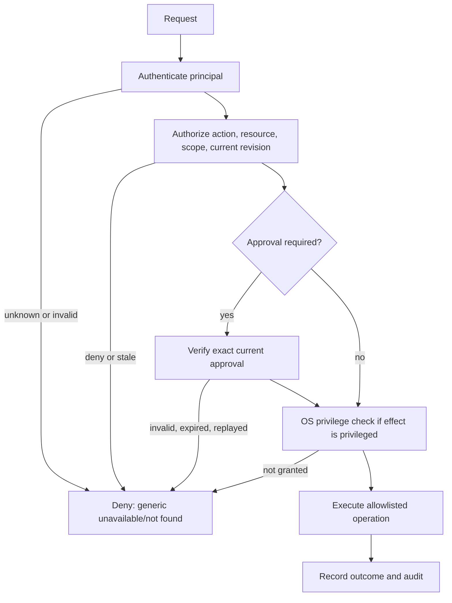
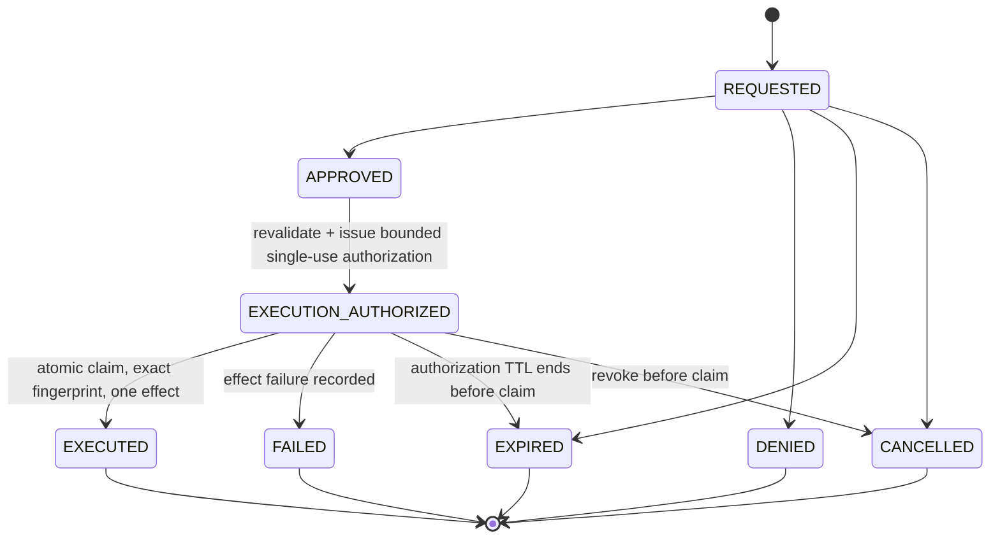

# Synveil v0.3 — P004 Security Policy Contracts

**Status:** proposed design contracts; no control described here is claimed implemented or approved.
**Baseline:** `develop/v0.3` at `6696361a3a39d25f2606bb48356b2bf6b2c89a0c` (P003 integrated).
**Scope:** documentation-only policy design. See [P001 baseline](../audits/P001_V02_BASELINE_AUDIT.md), [compatibility baseline](../audits/P001_COMPATIBILITY_BASELINE.md), [P002 architecture](../architecture/P002_SYSTEM_ARCHITECTURE.md), [P002 compatibility](../architecture/P002_COMPATIBILITY_CONTRACTS.md), [P002 decisions](../architecture/P002_ARCHITECTURE_DECISIONS.md), [P003 threat model](P003_THREAT_MODEL.md), [trust boundaries](P003_TRUST_BOUNDARIES.md), [requirements](P003_SECURITY_REQUIREMENTS.md), and [P003 decision review](P003_SECURITY_DECISIONS.md).

## 1. Contract language and evidence limits

MUST, MUST NOT, SHOULD and MAY specify a future implementation contract. Every item remains proposed pending the approvals identified in [the maintainer decision packet](P004_MAINTAINER_DECISIONS.md). Existing repository behavior is identified as observed only where the P001/P003 evidence and current source were inspected. Design recommendations do not demonstrate runtime enforcement, cryptographic correctness, native OS behavior, production readiness or release qualification.

The required roadmap file `Synveil-v0.3-Context-Roadmap-P001-P060.md` was not found in the repository/workspace. P002 phase ranges are used only as tentative feature ownership labels; no unseen roadmap requirement or sequence is inferred. No phase dependency can authorize work whose decision gate remains open.

## 2. Uniform policy model

Authentication, authorization, approval, OS privilege, and audit are independent decisions. A successful result in one layer is never a substitute for another. Authentication establishes a principal; authorization evaluates the current policy; approval records consent for one exact operation; privilege is the operating system's permission to cause an effect; audit records request, decision and outcome.

Illustrative Rust-compatible vocabulary (types are conceptual and do not define a wire or cryptographic format):

```rust
struct Principal { kind: PrincipalKind, id: PrincipalId }
enum PrincipalKind { User, Device, Service, Host, Cluster }
struct Actor { principal: Principal, session: Option<SessionId>, credential: Option<CredentialId> }
struct Host { id: HostId, installation: InstallationId }
struct Resource { kind: ResourceKind, id: ResourceId, owner: PrincipalId, host: Option<HostId> }
enum Action { Read, Write, Delete, Restore, Share, Enroll, Configure, Execute(EffectClass) }
struct Scope { resource: ResourceSelector, host: Option<HostId>, constraints: Constraints }
struct PolicyRevision(u64); // opaque, monotonic policy snapshot identifier
struct AuthzContext { actor: Actor, resource: Resource, action: Action,
                      scope: Scope, policy_revision: PolicyRevision, now: Timestamp }
enum Decision { Permit(GrantEvidence), Deny(DenyReason) }
struct ApprovalRequest { id: RequestId, requester: Principal, approver_authority: Scope,
                         operation: OperationFingerprint, policy_revision: PolicyRevision,
                         state: ApprovalState, expires_at: Timestamp }
struct ApprovalDecision { request: RequestId, approver: Principal,
                          decision: ApprovalOutcome, decided_at: Timestamp }
struct ExecutionAuthorization { request: RequestId, operation: OperationFingerprint,
                                nonce: SingleUseNonce, policy_revision: PolicyRevision,
                                expires_at: Timestamp }
struct AuditEvent { id: EventId, actor: Actor, subject: Option<Principal>, resource: Option<Resource>,
                    action: Action, decision: Decision, policy_revision: PolicyRevision,
                    approval: Option<RequestId>, correlation: CorrelationId,
                    occurred_at: Timestamp, outcome: ExecutionOutcome }
```

A Policy decision is deterministic for `(principal, resource, action, policy_revision, evaluation inputs)`. Inputs affecting a decision (account state, credential revocation, resource owner, explicit grants/denials, scope, expiry) must be explicit and read from an authoritative consistent view. Missing identity, ambiguous mapping, invalid scope or absent grant yields deny. Explicit revocation/deny overrides a stale positive cache. A cache may accelerate reads only if its revision/revocation fence is current; it cannot authorize a sensitive state change without commit-time revalidation.

`Permit` from application authorization means only that policy allows the action. It does not represent approval or OS privilege. A resource UUID, library ID, cluster membership, valid Tailscale peer, login, invitation or device identity is a selector/identity input, never authority by itself.

### 2.1 Decision sequence and failure contract



The service must not reveal whether another principal's resource exists. For unauthenticated/unauthorized cross-owner lookups, return the same public error class and materially equivalent response behavior for “absent” and “not visible”; record detailed reason only in protected audit/diagnostics. Do not leak owner, host, role, token, approval or persisted database details. For an already authenticated owner, safe validation errors may distinguish malformed input from a missing visible resource. Rejected actions have no effect; ambiguous execution is reported as unknown/needs inspection and is not blindly retried.

### 2.2 Required enforcement location

Authorization is enforced at the server/API/service boundary for every protected request and again at the durable mutation/effect boundary for sensitive state changes. Repository predicates must preserve owner/device/host scope. UI hiding is presentation only. Worker jobs carry explicit actor/authority context or a narrowly scoped service identity; they cannot inherit ambient user, cluster or root privileges.

## 3. Identity and credential lifecycle contracts

All credential secrets are high-entropy, bearer-secret material unless a separately approved proof-of-possession design exists. Store verifier/digest server-side where compatible with lookup; keep raw secrets out of logs, URLs, command arguments, crash diagnostics and ordinary profile databases. Client secrets use the platform secure store; unavailable protected storage fails explicitly. Every credential has a stable identifier distinct from its secret. Revocation is authoritative immediately for new requests and sensitive commit points.

| Class | Issuer, audience, principal and scope | Create, storage and use | Expiry, rotation, revocation and recovery | Replay, compromise and audit |
|---|---|---|---|---|
| Browser session | Auth service issues after user authentication; audience is one canonical Synveil origin; binds user + session record. Scope is current user permission, never role data supplied by browser. | Fresh opaque bearer; digest-only server persistence; host-only secure cookie; use with CSRF/provenance checks for mutations. Existing code has random token, expiry and revocation primitives. | Server-side expiry; reads do not renew authority. Rotate on reauthentication or security events. Revoke session/account explicitly. Recovery creates a fresh session; never restore a bearer from a session ID. | Replay after expiry/revocation denied; cookie/session IDs redacted. Audit login, session creation/revocation and security failures without recording token. Exact lifetime/renewal policy pending. |
| Device credential | Auth service; audience is the enrolled Synveil server origin/install; binds owner + device + credential ID. Scope is existing owner/device API authority, not host admin. | One-time grant exchange returns raw secret once; server stores verifier; Android Keystore/iOS Keychain/platform vault for clients. Existing enrollment grant is digest-only, ten-minute TTL and transactional one-use. | Credential expiry/rotation still requires an approved policy. Replace credential on same device as a new credential ID while retaining device ID, library binding and sync checkpoints. Revoke old credential before/at bounded overlap end. Device identity replacement is a separate explicit recovery and must not inherit checkpoints or other device state. | Duplicate exchange fails and never returns prior secret. Lost response requires revoke/re-enroll, not grant replay. Compromise revokes credential/device scope and audits impact; retained local queues remain untrusted pending reconciliation. |
| Enrollment grant | Existing authenticated owner/authorized enrollee issues; audience is one install and intended enrollment exchange; binds requester, target owner, target device/new-device intent and expiry. | Short-lived, high-entropy opaque secret; digest persisted; single atomic redemption; never embeds permanent device credential or executable command. Existing implementation binds owner/device and consumes once. | Expire quickly; no rotation, issue a fresh grant. Revoke/cancel by issuer. Recovery after ambiguous redemption is fresh grant + explicit credential cleanup. | Exactly one redemption wins; all later/replayed requests fail generically. Audit issuer, target, expiry, result, not raw token. |
| Pairing invitation | Authorized owner/operator issues for one server installation and target device/user; audience is exact enrollment service and server identity. | One-time, short-lived, constrained invitation; QR transports it but QR possession is not approval and does not authenticate the server. Persist verifier/state only; do not include long-lived credentials or commands. | Expire or cancel; rotate by issuing new invitation. Revoke on endpoint/server identity change or suspected image exposure. Recovery starts a new invitation. | Atomic state transition; no secret recovery after consumption; replay rejected. Audit create, display/issue, cancel, consume and failure without payload. |
| Future scoped API token | Explicit user/operator authority; audience is exact server/API; binds principal and credential ID. | Create only after approved scope and expiry model. Show secret once; digest server side, platform vault client side. Scope must be no broader than the grantor's current authority; prohibit shell/admin wildcard. | Bounded expiry; replace via overlap that does not outlive old token revocation; individual and principal-wide revocation. Lost token is revoked, never recovered. | Replay limited to its scope; high-impact APIs may need idempotency. Audit issuance, last use metadata, revocation and denied scope; no bearer logs. |
| Host identity | Proposed per-install identity issuer with distinct HostId; audience is one named Synveil installation/cluster verifier. | Create only through explicitly approved local bootstrap. Private key held by platform-protected storage where feasible; public identity bound to host/install record. | Per-host renewal/revocation; rotate host credential without silently replacing host identity. Replacement requires operator-attested recovery. | Host key replay accepted only by its intended audience; compromise isolates/revokes that host. Audit issuer, binding, rotation, revocation. Issuer/format pending. |
| DeviceVeil cluster identity | Proposed cluster authority issues cluster ID and relationships; cluster identity does not itself authorize a host or resource. | Named cluster record with explicit host membership; one host credential per host and one audience per service. No shared cluster bearer. | Remove/revoke hosts independently; cluster recovery cannot reactivate revoked hosts. Rotate trust roots under an approved transition. | Replay on unrelated host rejected. Compromise isolates one host and its contributions; unrelated hosts/ObjectStores deny. Audit membership and trust changes. |

A revoked credential remains revoked even if its device/host UUID still exists. Credential rotation preserves a device identity only after proof that the same enrolled device is being rotated; it never changes owner, canonical server, library, checkpoint, host, or cluster binding as a side effect. Identity replacement is separately approved, creates a new identity and requires explicit state-transfer authorization. No credential rotation policy, cryptographic format, key algorithm or wire field is finalized here.

### 3.1 QR first-contact server identity proposal

**Recommended default:** use a trusted in-person QR that contains a stable server installation identity/fingerprint obtained from the server's local trusted display, paired with normal HTTPS certificate and hostname validation; display the decoded endpoint, server identity, account and device on both sides for explicit comparison/confirmation before grant redemption. The QR must not supply the trust anchor by itself. If trusted in-person display is unavailable, require explicit short authentication string comparison over the authenticated channel, or an already pinned server identity. Never accept a hostname inside an untrusted QR as proof of server identity.

| Method | Attack assumptions and trade-off | Policy recommendation |
|---|---|---|
| Trusted in-person QR with server fingerprint | Resists remote QR replacement only if the user physically verifies the trusted server display and the fingerprint is bound to the same server identity; compromised display/operator can still lie. | Preferred first-contact default; QR carries opaque invitation plus identity fingerprint, not authority alone. Format/cryptographic binding pending approval. |
| Short authentication string (SAS) | Resists network/QR substitution if both endpoints derive/display the same value from an authenticated exchange and users compare it out-of-band; users may skip/incorrectly compare. | Acceptable fallback with explicit comparison, mismatch abort and no credential storage. Do not finalize cryptographic protocol here. |
| Previously pinned server identity | Strong against endpoint substitution while the pin remains trustworthy; recovery on legitimate server replacement requires safe out-of-band re-pin and may be unavailable after loss. | Preferred reconnect path; preserve pin across profile rename and require explicit change workflow. |
| Ordinary HTTPS to already trusted origin | TLS validates the origin under system PKI, but does not show that the user scanned the intended server if the QR can substitute a different valid hostname. | Sufficient only where the HTTPS origin was trusted independently before scan. Not a QR-only bootstrap. |

#### Invitation state machine proposal

| Current state | Event and preconditions | Next state | Effect |
|---|---|---|---|
| `CREATED` | Issuer displays/exports unexpired invitation | `ISSUED` | Record issuance; no authority yet. |
| `CREATED` or `ISSUED` | Issuer cancels before redemption | `CANCELLED` | Reject every subsequent use. |
| `CREATED` or `ISSUED` | Expiry reached before valid redemption | `EXPIRED` | Reject; issue a new invitation. |
| `ISSUED` | Correct endpoint identity, TLS, target and user confirmation; atomic redeem wins | `CONSUMED` | Bind exactly one new credential/device record; never return the credential on replay. |
| `ISSUED` | Wrong endpoint identity, audience, owner, device, policy revision, malformed request or stale authorization | unchanged or `REJECTED` terminal per approved implementation | No credential issued; generic public failure; protected audit detail. |
| `CONSUMED` | Duplicate, concurrent loser, replay or lost response | `CONSUMED` | No second credential and no secret recovery. Explicit revoke/re-enroll. |
| `CREATED` or `ISSUED` | Server identity rotation or compromise response | `CANCELLED` | Require new trusted first-contact ceremony. |

Negative cases: expired; cancelled; consumed/replayed; concurrent redemption; wrong server fingerprint; valid TLS for wrong QR hostname; invalid certificate; HTTP; redirect; changed owner/device; revoked issuer; stale policy; lost successful response; storage unavailable; copied QR used before intended user; invitation used at a second installation. Each must issue no unauthorized credential, reveal no foreign account/resource state, and leave an auditable denial. Invalid-context attempts leave the invitation ISSUED and do not consume it; rate limits and expiry bound retries. A successful atomic redemption, cancellation, or expiry is terminal. Exact encodings and cryptographic messages remain pending maintainer approval.

## 4. Legacy authorization and proposed role model

The existing owner/device model remains authoritative for v0.2-compatible operations. Current source has separate browser and device principals; device credentials bind owner/device/credential and API/metadata operations carry owner/library/device scoping. No general RBAC model is present in this baseline. Proposed role names below are candidates only.

For each operation calculate both `legacy_result` (the exact existing owner/device rule) and `new_policy_result` (candidate role/scope policy). For an existing principal/resource/action, effective permission is `legacy_result AND new_policy_result` during compatibility migration. A migration cannot grant new access by mapping an owner or device record to a broader role. For new operations/resources without a legacy rule, explicit approved grants govern; missing mapping denies. Do not create SQL in P004.

Candidate roles (approval required): `ResourceOwner`, `HostAdministrator`, `Collaborator`, `ReadOnly`, and narrowly scoped `Operator` for named service/maintenance operations. Role is a named grant, not an identity. Scope contains resource/library, host, action set, device binding, validity interval and optional constraints. Role inheritance is off by default; grants are non-transitive. Explicit deny/revocation wins over inherited or cached permit. Temporary grants have mandatory expiry and audit.

| Subject/policy concept | Proposed rule |
|---|---|
| Resource owner | Existing owner keeps only current v0.2 effective rights for existing operations. Transfer requires explicit owner-authorized operation and audit; owner is not automatically host administrator. |
| Host administrator | Applies to one named host installation. Admin of Host A has no authority on Host B or its ObjectStore. Host administration never follows tailnet/cluster membership. |
| Additional user/collaborator | Requires an authorized grantor and exact resource/host/action scope. Cannot regrant unless explicitly delegated. |
| Read-only | Allows only named read actions; no mutation, upload, restore, share, credential, approval or host operation. |
| Scoped writer | Allows specified mutation actions for listed resources only; no delete/restore/admin unless separately granted. |
| Device-specific access | Device credential is owner + device + credential bound. A device cannot act as another device or acquire cross-owner scope by supplying IDs. |
| Temporary access | Explicit start/expiry, narrow action and resource scope; deny after expiry or revocation even when cached. |
| Inheritance | No global or host-to-host inheritance. Resource children inherit only if a future approved rule explicitly defines it; default no inheritance. |
| Explicit denial | Deny beats role permit, group membership, cached permit, stale grant and resource identifier possession. |
| Revocation | Monotonic revision/fence; current DB/service state rechecked before commit. If unable to establish freshness, fail closed. |
| Host-specific permissions | Bound to HostId and installation; no cross-host implication. Cluster role (if ever approved) is topology only unless separately scoped grants authorize action. |

Migration proof strategy: inventory every legacy principal, owner/device/library binding and persistent checkpoint from a production-like copy; produce a deterministic before/after action matrix; prove for every old `(principal, resource, action)` that the new result is no broader; preserve opaque IDs, foreign keys, device/library bindings, checkpoints, queues and file history; run cross-account negative tests and restore/backfill rehearsal; support expand/backfill/verify/contract without rewriting identity; do not contract old checks until equivalence is proven and approved. Required checks include AT-07, AT-15 and AT-16 plus the compatibility tests enumerated in [implementation gates](P004_IMPLEMENTATION_GATES.md).

## 5. Approval and replay policy

Approval is a durable statement of consent, not an authorization grant, credential, or operating-system elevation. Each request binds: request ID; requester principal and credential/session context; required approver authority; operation class; exact resource and host; canonical material parameters or operation fingerprint; scope and privilege class; created/expiry times; policy revision; state; decision/approver; execution authorization issuance; and final execution outcome. The operation fingerprint must cover all effect-changing parameters, canonical serialization version and target identity. A fingerprinting algorithm/format awaits separate design and review.

Proposed state transitions:



Approval must be bound to a single operation, resource, host, canonical parameter fingerprint, privilege class, scope and policy revision. Before execution, re-evaluate requester and approver authority, current resource ownership, revocations, policy revision, target host and expiry. Issue a short-lived single-use execution authorization only after these checks. Atomically claim it so concurrent calls have exactly one winner; the second returns already-consumed. Retry after an unknown effect outcome requires reading the durable operation journal and explicit idempotency/reconciliation, never reusing approval for a second effect. Any changed command, parameters, resource, host, privilege, scope or policy revision requires a new approval.

Separate requester and approver for destructive, cross-user, credential, network exposure and privileged host operations. Self-approval is denied for these classes. Single-user installation: do not silently waive separation; either defer/block the operation or allow an explicitly maintainer-approved exception that records `self_approval_exception`, demands fresh local confirmation/native authorization where relevant and is narrowly limited. This exception is not a second approver and does not reduce OS checks.

Audit concept fields: event ID, prior-event/reference integrity data, timestamp and clock source, correlation/request IDs, actor/subject IDs, operation/action, resource/host, policy revision, canonical fingerprint (not secrets), approval request and decision, authorization result/reason class, OS authorization evidence reference, effect journal ID, result/partial/unknown state, recovery action and retention class. Protect confidentiality with least-privilege audit readers and secret redaction; protect integrity with append-only or tamper-evident storage, sequence checks, restricted deletion/alteration and independent backups. Audit failure blocks actions marked audit-required. Retention period, legal access, deletion and export policy are pending product/privacy/legal decisions; no duration is set here.

## 6. Privileged operation policy

A closed registry is required. This proposed catalog does not grant any current process new authority. A request passes application authorization + operation-specific approval if required + native OS authorization where the OS requires it + current effect/plan validation. Remote Synveil credentials, approvals, Tailscale membership, invitations and cluster membership never confer root/admin. No arbitrary root shell endpoint, unrestricted helper, arbitrary QR/invitation command or privileged installer wizard process is allowed. Preserve the existing install-engine transaction journal and bounded Linux helper protocol.

`Native authorization` below means platform-enforced authorization by the OS/package manager/service manager appropriate to the operation. Linux and Windows semantics are not interchangeable. The Windows implementation path for machine-wide effects is unverified; present Windows Setup is per-user. Passkeys/FIDO2 may be evaluated for application step-up but do not replace OS authorization, and platform support/attestation/user-presence behavior is unverified.

| Operation class | Application authority / confirmation | Native OS authorization | Parameters, targets and execution | Evidence, recovery and rejection |
|---|---|---|---|---|
| Install/upgrade package | Named host operator; explicit local confirmation; approval for remote initiated/high-impact update. | Linux package manager/polkit/sudo policy for exact package operation. Windows exact installer/UAC semantics must be designed; do not elevate wizard by default. | Signed/verified package identity, channel/version/digest, named install root and closed plan only. Execute through existing install-engine/package adapter. | Artifact provenance, plan fingerprint, native result and append-only install journal. On interruption inspect journal and preserve data; unknown artifact/actor/plan denies before effect. |
| Change service configuration | Host operator; confirmation showing exact fields/diff; approval if remote or exposure/credential changes. | Linux narrowly scoped helper/service authorization; Windows service control ACL/UAC path separately designed. | Typed allowlisted config fields for one HostId/service; no arbitrary file path or shell. | Before/after hashes, config generation and journal. Failed validation leaves old config; ambiguous partial change pauses for operator repair. |
| Start/stop approved service | Host operator; confirmation for remote/destructive lifecycle. | Native service manager authorization (Linux systemd/polkit; Windows SCM access/UAC). | Enumerated Synveil-owned service IDs only; no arbitrary process. | Request/plan, service status and journal. Failure reports unavailable; no alternate service fallback. |
| Network configuration | Host operator; explicit confirmation of listener, interface, firewall and origin; independent approval for public exposure. | Linux firewall/helper or Windows firewall/adapter authorization separately verified. | Closed reachability modes, observed interfaces, validated endpoint; no arbitrary port-forwarding or public listener. | Capture before/after listener/firewall and endpoint identity. Revert only through journaled safe plan; invalid plan denies. |
| Credential/service ownership changes | Host operator and current credential owner; independent approval for ownership transfer/rekey. | Native account/service ACL mechanism for OS-owned identities. | Named Synveil account/service/secret references only; no arbitrary account or file ownership tuple. | Audit old/new principal IDs, not secret; recovery keeps service stopped/unavailable rather than broadening ACL. |
| Protected Area configuration | Resource owner for app-managed policy; host operator plus separate design for native enforcement; approval for removal/weakening. | Required only for a named/tested OS mechanism; not implied for app-managed gates. | Stable resource IDs, scope, rule revision and exact protection level; no universal directory blocking claim. | Rule revision, baseline/hash and change audit. Integrity uncertainty denies protected Synveil mutation and preserves prior version. |
| Snapshot or restore | Resource owner/authorized backup operator; explicit confirmation of source, destination, point and impact; independent approval for destructive/host rollback. | Native authorization only for OS/database tools that require it; separate operator credentials. | Named recovery domain and verified manifest; no arbitrary paths/SQL/shell. Existing file-version restore remains a new immutable version. | Verify completeness before destructive step; record manifest/object identities and restore journal. Partial restore is explicit; stop on mismatch. |
| Destructive host operations | Host operator; independent approver except documented single-user blocked/exception policy; explicit local confirmation. | Exact native OS elevation; no remotely supplied token can satisfy. | Closed operation IDs and named host target. Destructive command arguments are typed and bounded. | Durable intent/result, impact summary and recovery boundary. Deny if audit, approval, target identity or native authority is unavailable. |

Linux-specific: current source includes a Linux-purpose host helper, bounded framed protocol and Polkit action, plus package manager and systemd integration. These do not establish authorization for future effects. Extend only with closed typed operations, fresh plan/effect checks, actor binding and journal evidence. Windows-specific: current native installer targets the current user and existing standard-user acceptance work has unresolved unavailable-surface CI failures. Machine administrator/SCM/firewall semantics must be evaluated independently; do not infer Polkit equivalence. macOS and mobile native privileged operation support is not established. Unsupported operation/platform combinations must fail unavailable without fallback.

## 7. SynveilNet connectivity and endpoint trust

Proposed default is local-only, loopback listener for managed service. Private LAN, optional Tailscale transport and operator-managed HTTPS are opt-in, explicit modes. No automatic public exposure, listener expansion, plaintext downgrade or weakened server identity check. Current `synveil-server-network` has side-effect-free reachability planning; it classifies tunnels separately and excludes them from private-LAN candidates. Existing mobile endpoints require HTTPS outside debug numeric loopback. No Tailscale integration exists in this baseline.

| Mode | Listener and identity contract | Connection and failure policy |
|---|---|---|
| Local-only (default) | Bind loopback only; managed backend remains local. Authenticate peer/user by normal application auth; loopback is not authorization. | Remote profile is unavailable. Do not broaden bind on failure. |
| Private LAN | Explicitly choose an observed private interface and listener/firewall plan; exclude tunnel/bridge heuristic alone as identity. HTTPS with authenticated server identity. | User approves endpoint and enrollment; endpoint binding persists by canonical origin + server identity. Invalid/multiple interface or TLS mismatch fails closed. |
| Optional Tailscale | User/operator explicitly enables adapter; listener exposure is scoped to selected interface/address and approved plan. Normal HTTPS identity and Synveil auth remain mandatory. | Tailnet peer is reachability only. Revoked membership or tunnel outage gives unavailable; no LAN/public fallback and no trust of peer name alone. |
| Operator-managed HTTPS | Operator controls origin/proxy/cert/edge configuration; Synveil trusts only configured canonical origin/proxy chain. | Explicit reverse proxy configuration; invalid certificate/origin/forwarded provenance rejects. No silent managed-edge takeover. |

Transport capability discovery is unauthenticated metadata at most and never permission. Persist a binding of canonical endpoint, server installation identity/fingerprint, transport mode, owner/device and credential association. Changing origin or server identity requires explicit migration/re-enrollment after verified identity transition; preserve queued local work but do not send it until trust is re-established. Certificate mismatch, unexpected redirect, DNS/end-host mismatch or TLS validation failure stops before sending credentials. On Tailscale membership revocation, invalidate transport availability and require renewed operator action; the app principal/permissions remain independently evaluated. Visible states should distinguish “server unreachable”, “server identity changed”, “certificate invalid”, “access revoked” and “configuration needs attention” without exposing foreign identity data.

Proposal-level acceptance includes AT-23–AT-26 plus: enumerate listeners before/after each mode; simulate tailnet outage/revocation and prove no fallback; replace certificate/hostname and prove credential not sent; test multiple/no LAN candidates; verify mode and endpoint survive restart; verify all supported client TLS behavior. Real-network evidence must identify OS, server/client versions, actual interface/listener/firewall state, certificate chain, peer identity/ACL, packet capture, revocation and outage results. Unit mocks are not real-network evidence.

## 8. Protected Areas and integrity

Two separate claims:

1. **Application-managed protection:** API and supported clients gate Synveil-managed operations using current policy, approval (when required), resource identity and expected version/hash. This does not block arbitrary host filesystem writes, other applications, root/admin or direct storage access.
2. **Native OS enforcement:** optional stronger protection only after a named per-OS capability has a threat model, privilege design, supported-version matrix, bypass/administrator analysis, installation/signing lifecycle, recovery/removal design and native tests. No platform-wide claim follows from another OS's results.

Contracts: resource identity is stable logical `(owner, library, node/file)` plus host and immutable version; never infer it from path or opaque object key alone. Classify operations as read, create, modify, delete, restore, move, share, policy-change, protection-removal. Record baseline version and content hash; bind approvals to exact resource, operation and expected old/new hashes. Replace content via validated same-filesystem temporary object, fsync/flush where supported, atomic rename where supported, verify new hash, then publish metadata transaction; preserve old immutable version until durable commit. Atomicity across filesystem, PostgreSQL and ObjectStore is not assumed. Use handle-relative/no-follow APIs or equivalent to avoid symlink/path races; revalidate path identity and authorization at the point of replacement. If platform cannot provide required race defense, reject or state narrower guarantee.

Integrity mismatch or incomplete upload leaves prior valid version readable and unpublished candidate quarantined/repairable; do not silently accept new baseline. Restore/repair creates a new immutable version, verifies references and hash, and records approval/audit. Removing protection requires resource authority, explicit confirmation and (for high impact) independent approval; revocation takes effect before later writes. All failures retain old data and return a generic cross-user-safe response. Preserve existing file-version immutability and conflict behavior; no automatic merge, kernel module or filesystem driver in P004. See AT-31–AT-35.

## 9. Snapshot, backup and recovery policy

A recovery claim names its recovery domain; successful recovery of one domain does not prove another is recoverable.

| Domain | Completeness boundary and requirement |
|---|---|
| File-version restore | A selected immutable version and referenced object are readable/authorized; restore appends a new version and preserves history/conflicts. |
| Logical application snapshot | Metadata view and journal high-watermark are captured from one consistent DB view; only logical metadata, not ObjectStore bytes, unless separately listed. |
| PostgreSQL backup | Database cluster/schema/roles/configuration/WAL coverage is declared; test restore to an isolated target and record point-in-time boundary. |
| ObjectStore backup | Exact object namespace, versioning/encryption metadata and hash inventory are declared; validate bytes independently. |
| Client-local state | Profile, secure credential references, pending mutation queue, checkpoints, conflicts and transfer state are accounted for; never reset identity/checkpoints as generic repair. |
| Host filesystem snapshot | Exact filesystems, mount boundaries, databases and service-consistency hooks are named; does not imply cross-host or application consistency. |
| Full host rollback | OS, boot/system state, secrets, databases, ObjectStore, external dependencies and rollback mechanism are all included and rehearsed. Application-level backups alone cannot claim it. |

Future coordinated PostgreSQL/ObjectStore manifest should contain format/version; unique recovery-point ID; capture start/end and declared consistency boundary; database backup identifier/LSN or equivalent; ObjectStore namespace/version and object inventory root; every referenced object ID, size and cryptographic hash; metadata-to-object reference set; encryption/key identifiers (never raw secrets); tool/build identity; host/install identity; signer/key ID and signature; completeness state and exclusions. Integrity requires authenticated manifest signing or equivalent tamper evidence with key rotation/revocation policy, plus independent object hash/length verification and reference closure. Merkle/root structures may be considered, but no cryptographic format is selected. PostgreSQL and ObjectStore are not cross-store atomic: capture/pin the candidate object set and a DB recovery point, verify closure, then publish the manifest as complete; mismatch yields incomplete/unusable point.

Restore order proposal: authorize caller and target; read/verify manifest and signer; stage and hash-check all required objects; restore database into isolated target at declared point; restore/import object bytes; verify reference closure and application invariants; rotate/revoke secrets that may have been reintroduced; only then switch service/namespace and record completion. Never overwrite target before preflight completeness where staging permits. Every step has durable intent/result and a restartable restore journal. On interruption, resume by verified idempotent step or stop for operator inspection; do not assume atomic rollback. Partial restoration is explicitly labeled and isolated from normal service. Restore rechecks current target authorization and requires destructive-operation approval when replacing state. Host/system rollback remains an operator/provider domain unless separately designed and tested. Retention duration and deletion policy require privacy/product/legal approval. See AT-34–AT-38.

## 10. DeviceVeil optional trust contract

DeviceVeil remains an isolated optional integration. Single-host Synveil must work and remain authoritative while DeviceVeil is disabled, partitioned or offline. Named clusters, trusted host enrollment, per-host roles, quotas, priority, logical storage/topology and one-time bootstrap are possible product concepts only; none is implemented or approved here.

Prerequisites: a named issuer/trust root for host identities; host-to-cluster relationship signed/recorded by cluster authority and independently verified by each participating host; host credential audience bound to one host/service and purpose; per-host revocation checked online or under a bounded offline policy; explicit per-host role and resource contribution quota; cross-host operations authorized by both source/resource owner and target host policy; bootstrap artifact pinned to publisher identity/hash and delivered once with short expiry; operator approval before host admission; partition policy denies new cross-host sensitive actions while local host continues; host removal revokes credential, scheduler/contribution authority and object access; compromise isolates only that host and audits potentially affected resources. No shared bearer or implicit host administrator from membership. A compromised node cannot authorize unrelated hosts or read/write their ObjectStores.

Acceptance requires at least two isolated real hosts plus invalid audience, revoked host, replayed/expired invitation, quota exceedance, partition, host removal and compromised-host exercises (AT-39–AT-42). Until host identity issuer, trust root, quota semantics, partition rules and bootstrap signer are approved, implementation is blocked.

## 11. Cross-cutting traceability anchors

Policy contracts reuse P003 identifiers. The critical/high complete row-by-row trace, responsible component, failure behavior, verification and roadmap caveat are in [P004 implementation and verification gates](P004_IMPLEMENTATION_GATES.md). Related tests: AT-01–AT-45 in [P003 requirements](P003_SECURITY_REQUIREMENTS.md); no IDs are renumbered. P002's suggested phase ownership remains provisional until the missing roadmap is reconciled.
