# Synveil v0.3 — P020 pairing trust and invitation contracts

**Status:** provisional design and non-production executable contract; pairing authorization and cryptographic first-contact decisions remain unapproved.  
**Base:** `develop/v0.3` at `fea3c9307f30318e7ce275fbd406c733cfa145d8` (P019 #179 merged).  
**Scope:** audit, typed reference contracts, deterministic tests and focused CI only. No production route, database migration, invitation issuance, enrollment behavior or mobile-client behavior is added.

## 1. Baseline and scope limits

The specified source baseline was verified. The required original document `Synveil-v0.3-Context-Roadmap-P001-P060.md` is absent from this checkout and workspace. P002, P003 and P019 also recorded it as unavailable. P020 therefore remains provisional and cannot be accepted as roadmap-complete until an authorized copy is reconciled against the P001–P060 assignments and sequencing. This document does not infer ownership from tentative P002 ranges.

P004-D12 (QR first-contact server identity) and P004-D13 (device credential lifetime and rotation) remain `RECOMMENDED_PENDING_APPROVAL`. The proposed model below is a reviewable contract fixture, not a decision record and not authorization to implement the pairing flow.

### Existing security primitives audited

| Surface | Existing behavior observed at the base | P020 reuse and limit |
|---|---|---|
| `sve1_` one-time grants | `crates/core/src/device_secrets.rs` defines distinct, versioned `EnrollmentSecret` and `DeviceCredentialSecret`, domain-separated SHA-256 verifiers, constant-time comparison, redacted `Debug`, and zeroization. `crates/auth/src/device_credentials.rs` sets a 600-second grant TTL and returns a raw grant once. | Keep the type/purpose separation and high-entropy verifier pattern. The proposed QR contains neither `sve1_` nor any raw verifier/secret. No new grant or credential is issued by P020. |
| Enrollment transaction | `crates/metadata/src/device_credentials.rs::consume_grant_with_clock` locks active owner, device and grant; checks owner/device state, grant digest, revocation, consumption, expiry and device freshness; inserts one credential verifier and consumes the grant within a transaction. A failed/lost exchange cannot recover the original bearer. | A future invitation adapter must atomically recheck current issuer, installation, device and policy and commit the single-use transition with credential insertion. Existing transaction behavior is evidence to reuse, not proof that a future invitation flow exists. |
| Production API | `crates/api/src/device_auth.rs` exposes the existing owner-authorized grant create/revoke and one-time exchange flow. Enrollment remains under existing auth and owner/device checks. | No route, DTO, OpenAPI operation, middleware or authorization change is included. Existing enrollment is unchanged. |
| Server identity / endpoint | Existing clients validate HTTPS endpoints and reject invalid TLS/redirects; P019 adds read-only installer network/path preflight and does not establish pairing trust. Existing endpoint validation does not authenticate a first-contact QR's intended installation. | Pairing must require normal authenticated HTTPS and an independently approved identity check. A QR-provided host or fingerprint alone is not a trust anchor. |
| Android credential protection | Android enrollment preflights the secure vault before exchange, stores credentials using the Keystore-backed vault, scopes metadata to profile/origin/owner/device, and requires recovery after ambiguous exchange/storage failure. | Preserve these bindings and fail-closed secure-store behavior. No Android QR flow or storage changes. |
| iOS credential protection | iOS enrollment validates the token, validates authorization before exchange, stores device credentials in the device-only Keychain store and treats ambiguous response or Keychain failure as recovery-required. | Preserve the Keychain boundary and never place a bearer in QR/profile/SQLite. No iOS pairing or storage changes. |
| P004 policy | P004 §3 proposes one-time pairing invitation requirements and a QR first-contact ceremony; D12 and D13 remain pending approval. | This P020 artifact makes the policy executable as a negative-test reference only. |

Evidence paths: [P004 contracts](P004_SECURITY_POLICY_CONTRACTS.md), [P004 decisions](P004_MAINTAINER_DECISIONS.md), [P004 gates](P004_IMPLEMENTATION_GATES.md), [P005 legacy authorization baseline](P005_LEGACY_AUTHORIZATION_BASELINE.md), [Android enrollment](../../../clients/android/app/src/main/java/com/synveil/android/data/enrollment/EnrollmentManager.kt), [iOS Keychain store](../../../clients/ios/Infrastructure/Security/KeychainCredentialStore.swift), and [P019 transport preflight](../network/P019_INSTALLER_NETWORK_PREFLIGHT.md).

## 2. Invitation and QR contract proposal

The version-1 typed QR payload is in `crates/pairing-contracts`. It binds:

- invitation contract version and unique invitation identifier;
- exact server installation and issuing owner;
- fixed enrollment audience and the approved HTTPS endpoint;
- approved server identity fingerprint;
- intended device identifier;
- issue/expiry times and the policy revision that authorized issuance.

The type has no field for an enrollment grant, device credential, administrator token, privileged command, or installer script. Deserialization rejects unknown fields. QR possession is only a locator for a pending invitation. It does not prove control of the server, authenticate the HTTPS peer, authorize enrollment, or replace explicit confirmation. The executable evidence fixture also requires a separately verified one-time claim proof; it is a test fact, not a client-supplied assertion. Its mechanism is unresolved: a future design must formally approve the proof/owner-approval ceremony before an identifier can be redeemed. The fingerprint syntax and field set are contract fixtures pending D12 approval, not an approved wire encoding or cryptographic format.

Before any future redemption request, the client must parse strictly, display the endpoint/server/account/device identity, connect over HTTPS with standard certificate and hostname validation and no downgrade/redirect, compare the authenticated server identity with the independently trusted identity required by the approved ceremony, and require explicit user confirmation. A mismatch, inability to validate, or refusal aborts before secure credential storage. An attacker who substitutes a QR cannot substitute a valid TLS peer and have the client accept it solely because the QR names that peer.

## 3. State machine and atomic redemption contract

```mermaid
stateDiagram-v2
    [*] --> CREATED
    CREATED --> ISSUED: owner issues after current authorization
    CREATED --> CANCELLED: owner cancels
    CREATED --> EXPIRED: expiry reached
    ISSUED --> CONSUMED: one atomic eligible redemption wins
    ISSUED --> CANCELLED: owner cancels or issuer/identity is revoked
    ISSUED --> EXPIRED: expiry reached
    ISSUED --> ISSUED: rejected attempt; no state or credential change
    CONSUMED --> CONSUMED: duplicate/replay; generic rejection
    CANCELLED --> CANCELLED: every redemption rejected
    EXPIRED --> EXPIRED: every redemption rejected
```

`CREATED → ISSUED` requires current owner authorization. `CONSUMED`, `CANCELLED`, and `EXPIRED` are terminal. Wrong issuer/installation/audience/device, unauthenticated HTTPS, invalid TLS or fingerprint, stale policy, revoked owner, and missing user confirmation reject without consuming the valid invitation, so a safe correction can be retried before expiry. Public responses must not disclose another owner's or installation's existence; internal audit may record a bounded rejection class without tokens or QR contents.

Redemption must be a single durable transaction (or equivalent atomic compare-and-consume) that rechecks issuer activity, exact installation, audience, device target, expiry and current policy revision at commit time; changes invitation `ISSUED` to `CONSUMED`; and inserts exactly one credential verifier/binding. Concurrent requests produce at most one commit. Rollback on any failed insert leaves both invitation and credential state unchanged. Replays never return, reconstruct or issue the original credential again. This contract does not define the database representation, lock order or production route.

## 4. Safe failures and recovery

| Condition | Required behavior |
|---|---|
| Expired invitation | Reject; mark expired; owner creates a new invitation. Do not extend expiry or revive old data. |
| Issuer revoked/inactive | Reject at commit time. Cancel pending invitations on revocation where the future durable model permits; never use a stale positive authorization cache. |
| Wrong installation, endpoint, audience, owner or device | Reject without credential issue. Do not silently rewrite the invitation binding. Require an owner-issued new invitation if the intended target was wrong. |
| Duplicate scan / concurrent redemption | Only one attempt can consume. All others get a generic already-used/rejected result; no second credential is created. |
| Lost response after server commit | Treat outcome as ambiguous. Do not replay for a replacement secret. Owner revokes the unknown credential/device binding using existing authorized recovery and starts a new invitation. |
| Secure credential store inaccessible | Do not claim enrollment success. Keep local work unauthorized and follow explicit recovery; do not persist the bearer in profile, QR, logs or ordinary database storage. Existing Android/iOS flows already fail closed at their secure-store boundary. |
| Server identity rotation | Reject old fingerprint/pin until a separately approved out-of-band re-verification. Never silently accept a new identity from the same QR hostname. Cancel/reissue pending invitations under the new identity. |
| Stale policy revision | Reject at commit; do not auto-upgrade the invitation's authority. Owner must issue under current policy. |
| Forged QR / malformed or unknown fields | Reject before network use. Bound payload size in future parsers and do not execute payload fields. |

## 5. Compatibility and migration considerations

P020 changes no route, authorization decision, migration, OpenAPI schema, Android or iOS persistence contract. Existing v0.2 enrollment grant creation/exchange and device bearer storage remain as-is. The standalone `synveil-pairing-contracts` crate has no dependency from production crates; its mutex ledger is an in-memory state-machine oracle, not the authorization or persistence implementation.

A future approved implementation will need a versioned additive API and server-side invitation storage with a unique identifier, digest-only redemption proof if one is approved, owner/device/install binding, policy revision, timestamps, terminal-state evidence, audit metadata and concurrency-safe consumption. Any migration must be separately reviewed under P002's forward-only migration rules; no schema is selected here. Mobile support must be capability-gated and keep existing profile, endpoint, owner, device, Keychain/Keystore, offline queue and checkpoint bindings intact. Do not invalidate deployed credentials or change authorization when introducing a future pairing capability.

## 6. Assumptions, unresolved decisions and gates

- P004-D12 must approve the first-contact identity anchor, QR content and binding, endpoint-change ceremony, SAS fallback and recovery. No cryptographic construction is selected here.
- P004-D13 must approve device credential lifetime, overlap, replacement and recovery; P020 does not choose these values.
- The authoritative P001–P060 source roadmap is unavailable in the exact-base repository/workspace. Reconcile its original assignments, dependencies and acceptance language before P020 is accepted as complete.
- P004, P028 Windows native acceptance, P036 production publisher/inventory and native qualification, Windows Clippy, and real-tailnet qualification obligations remain open. Linux/Windows CI for this pure contract crate does not satisfy those obligations.
- This local review is not an independent security review, physical Android/iOS ceremony, TLS interception exercise against a production pairing service, or authorization approval.

## 7. Verification boundary

The deterministic fixture covers QR field rejection, HTTPS/fingerprint syntax, forged and unsafe QR values, wrong issuer/installation/endpoint/TLS/device, revoked owner, stale policy, lack of user confirmation, cancellation, expiry, duplicate scans, replay and 16-way concurrent redemption. It proves only the behavior of the isolated in-memory reference crate. It does not prove durable SQL atomicity, production endpoint authorization, cryptography, real TLS identity ceremony, secure hardware behavior or mobile compatibility.
