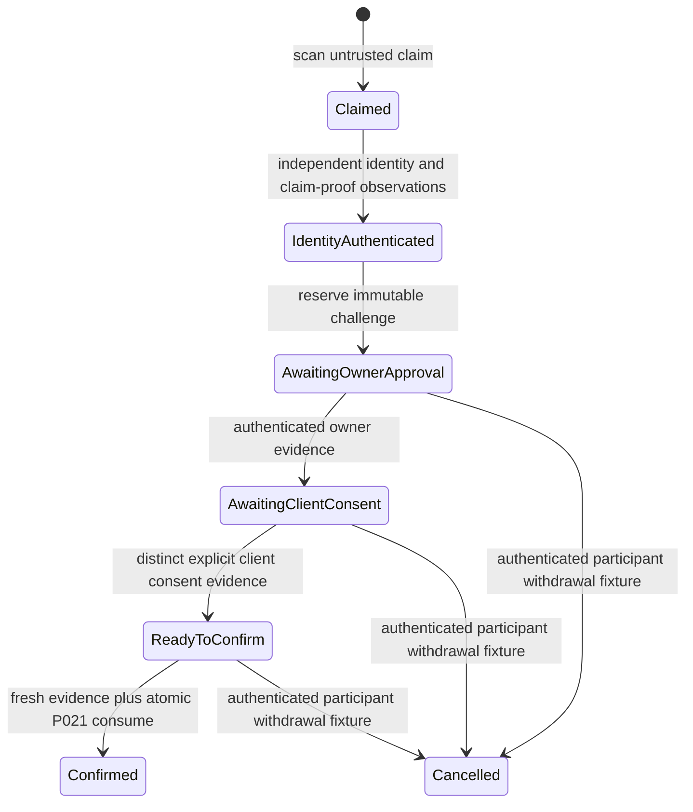

# P022 — First-contact pairing ceremony qualification

Status: **PROVISIONAL / NON-PRODUCTION / D12 AND D13 UNAPPROVED**.
Base: `6d03f35c9db632af7789396aed24e6630f45aefd`, P021 PR #181 merged.

## Audit and scope

| Audited surface at the exact base | Finding and constraint |
|---|---|
| P020 `crates/pairing-contracts/src/lib.rs` | Strict versioned QR, exact invitation binding, negative tests and a mutex oracle. Its proof/TLS/confirmation booleans are trusted test observations. Neither QR possession nor a QR fingerprint establishes trust. P020 behavior is preserved. |
| P021 `tests/support/mod.rs` and `schema_v1.sql` in that crate | File-backed SQLite uses `BEGIN IMMEDIATE`, current authority, immutable invitation binding, one collapsed approval and atomic consume plus synthetic marker insertion. That approval conflates identity, claim proof and user confirmation. P022 separates those observations and projects its final result into P021 inside the same transaction. |
| `crates/core/src/device_secrets.rs`, `crates/auth/src/device_credentials.rs` | Distinct purpose-separated `sve1_` and `svd1_` types; redacted secrets, digest verification, zeroization and a 600-second enrollment grant. None is used or changed by this work. |
| `crates/metadata/src/device_credentials.rs`, `crates/api/src/device_auth.rs` | Existing owner-authorized issuance/revocation and grant exchange lock owner/device/grant, recheck current state and time, then insert the credential verifier and consume atomically. A lost committed response cannot retrieve the bearer. Production routes, auth and migrations are unchanged. |
| `crates/core/src/host_trust.rs`, `crates/client/src/transport.rs` | Existing profile trust binds installation/network/origin/generation and managed CA where configured. HTTPS and discovery checks do not establish the intended first-contact installation from an untrusted QR. P022 imports none of those trust anchors. |
| Android `EnrollmentManager.kt`, `CredentialVault.kt`, `SynveilHttpTransport.kt` | Enrollment preflights the vault, binds profile/origin/owner/device/credential, reads back secure storage and requires recovery after ambiguity. Network transport rejects redirects. P022 adds no camera, Android flow, vault or profile change. |
| iOS `EnrollmentExchangeService.swift`, `KeychainCredentialStore.swift`, `URLSessionHTTPTransport.swift` | Exchange is single-shot with authoritative token validation, bounded response parsing and ambiguous-response recovery. Keychain uses non-synchronizable, device-only accessibility; endpoint binding and read-back remain existing boundaries. Redirects are rejected. No iOS behavior changes. |

The only new library module is the isolated, unpublished
`synveil-pairing-contracts::ceremony`. No production crate depends on it.
SQLite integration remains exclusively under `crates/pairing-contracts/tests/`;
no runtime migration, route, enrollment, credential, trust anchor or network
operation is added. Existing v0.2 Android/iOS interfaces and persisted data are
unchanged. Source isolation and Rust regressions are compatibility evidence;
they do not qualify physical mobile behavior.

A separate inherited Windows Clippy repair scopes the maintenance worker's
Linux-only health-window/counter-clone declarations to Linux and explicitly
discards readiness results elsewhere. Both existing readiness checks still
execute on Windows. It changes no authentication, enrollment, storage or
migration behavior and adds no lint allowance. The prior hosted failure and
separate repair SHA are recorded in the manifest.

## Typed version-1 contract

`ClaimRequest` contains a ceremony ID, version and P020 QR **claim**.
`BoundRequest` contains a version and the entire `ChallengeBinding`:
ceremony version/ID, synthetic challenge ID, issue/expiry times, and every P020
invitation field (including installation, endpoint, owner, device, fingerprint,
audience, invitation ID, policy revision and issue/expiry times).

Unknown and duplicate JSON fields fail deserialization, including nested QR
fields. Unsupported versions fail transition checks. Responses carry only a
version, ceremony ID, state and optional challenge; `validate()` checks their
structure/version. Response validation is not identity authentication. There
are no wire fields for positive TLS/proof/approval/consent assertions or secrets.
Requests must match the complete stored binding, byte-for-byte for strings.
There is no endpoint normalization, redirect adoption, automatic trust upgrade
or invitation rebinding. A future network parser must additionally bound body
size before decoding; no production parser is introduced here.

Every nonterminal state may be revoked; time-checked transitions become expired
at the inclusive invitation/challenge deadline. Confirmed, cancelled, expired
and revoked are terminal. Early withdrawal before a challenge is modeled by
the trusted harness's `revoke()`. A rejected binding/identity/decision cannot
advance the phase. Trusted observed time cannot move backward. A response is a
snapshot, not a promise of continuing validity; every advancing step checks
fresh facts and time again.

## Independent identity and reference evidence

`ReferenceFacts`, `ReferenceServerIdentity`, `ReferenceTls` and
`ReferenceDecision` deliberately do not implement wire deserialization. They
are privileged **harness inputs**, not production verifiers. Public fixture
constructors/fields do not make these facts authentic. Never build them by
copying positive assertions from a request or QR. The serializable
`ReferenceCeremony` snapshot is trusted database state only; accepting a client
snapshot would bypass this contract and is forbidden.

The harness independently provisions installation, exact endpoint and
fingerprint, then simulates certificate/hostname authentication. The QR must
match both the authoritative invitation and that independent observation.
Missing independent identity, valid TLS for another installation/origin,
wrong fingerprint, invalid certificate/hostname, unauthenticated transport and
redirect all deny. A QR changed to name an attacker's valid HTTPS server fails
against the independent fixture identity even if the supplied invitation claim
is changed to match it. No TLS handshake, server signature, possession proof,
SAS protocol or cryptographic transcript is implemented by these tests.

The separately verified invitation claim is another trusted fixture fact;
neither the invitation ID nor target device ID proves possession. How to
authenticate the candidate device and bind a one-time proof remains a D12
decision. The reference challenge ID is a unique database locator, never a
selected nonce format, secret or production proof.

Owner approval and client consent have separate evidence IDs and principal
bindings, exact challenge bindings, issue/expiry times and revocation state.
The owner must match the invitation issuer; the consenting client must match
the target device. Consent must follow the approval event, with a distinct
evidence ID. Their validity intervals must lie inside the challenge interval;
future-dated, pre-challenge, expired and revoked evidence fails. Accepted
evidence IDs, principals and time windows are recorded and cannot silently be
replaced or extended. Approval is rechecked at consent and confirmation;
consent is rechecked at confirmation. Observed revocation of accepted evidence
terminates the pending ceremony. A fresh owner approval or consent cannot
resurrect a terminal ceremony.

Current target-device eligibility is a separate trusted fixture fact from both
issuer activity and consent revocation. A missing or inactive device-authority
row fails closed, even with an active issuer and otherwise valid consent.
Device revocation is re-read under the same writer fence as confirmation and
terminates the ceremony; restoring device activity cannot revive it. These
fixture rows do not authenticate an actual device or change production device
credential state.

## SQLite composition, concurrency and recovery

P022's test-only tables store a ceremony snapshot, an independently provisioned
identity observation and two distinct participant events. Unique constraints
reserve ceremony IDs, invitation IDs and challenge IDs. Trusted test database
writers and the OS remain inside the fixture trust boundary.

Each approve/consent/confirm/cancel operation acquires `BEGIN IMMEDIATE` before
reading time, ceremony, current authority, independent identity and participant
events. At confirmation it rechecks all evidence; inserts the P021 approval
projection; invokes P021's extracted `redeem_locked` checks; and persists the
confirmed snapshot and synthetic verifier in the same transaction. The
extraction is test-support-only; the original P021 `redeem` entrypoint retains
its writer fence and all checks. No actual credential or cryptographic verifier
is created. A failed marker insert rolls back the ceremony, approval projection
and invitation consumption together.

Reference confirmation evidence is that committed snapshot: the complete
challenge binding, recorded approval/consent evidence IDs, principals and time
windows, confirmation's observed time, and matching P021 consumed invitation
and synthetic marker. A client-supplied `confirmed` assertion is never accepted
as evidence. This is a reference transaction record, not a signature or proof.

Independent connections serialize confirmation, withdrawal, expiry and
revocation. Sixteen simultaneous confirmations yield one commit and one
synthetic marker. Cancellation either wins first or loses to a committed
confirmation. Revocation committed before confirmation's writer fence denies;
a revocation serialized after a successful confirmation cannot undo that
commit. Subsequent real credential revocation would require existing authorized
recovery, whose production implementation is outside P022.

Cancellation terminates the P022 ceremony and retains its unique invitation
reservation. The P021 invitation stays issued without an approval projection,
so it cannot be redeemed through this harness or reused for another ceremony.
This does not qualify a production invitation-cancellation adapter.

Lost approval/consent/confirmation responses can query an exact-bound,
identity-checked metadata snapshot after reopening the database. Repeating a
completed action denies; recovery returns no bearer and creates no replacement
credential. If a future production credential handoff has an unknown committed
outcome, use authorized revocation and a new invitation; never reconstruct or
reissue a bearer through replay. The P022 reconnect tests complement P021's
child-process exit and rollback-journal tests. They do not qualify physical
power loss, storage anti-rollback, malicious database edits or device hardware.

## Deterministic verification and limits

The focused Ubuntu/Windows workflow runs P020/P021/P022 tests, existing
auth/API/client/client-sync/server-network regressions, formatting and strict
all-target Clippy. Tests include all invitation field substitutions, wrong
fingerprints and installation/endpoint, TLS mismatch/redirect, missing claim
proof, absent approval/consent, cross-ceremony replay, altered evidence windows,
expired challenges, clock rollback, stale policy, issuer and participant
revocation, ordered writer-fence races, sixteen-way contention, cancellation,
failed-insert rollback, duplicate reservations and lost intermediate/final
responses. Exact SHAs and observed hosted conclusions are recorded in
[PROMPT022_MANIFEST.md](../manifests/PROMPT022_MANIFEST.md).

Simulated identity, UI and secure-storage boundaries do not qualify a native
camera, real TLS interception, secure hardware, Android Keystore, iOS Keychain,
physical Android/iOS pairing or a real tailnet. Existing auth unit tests are not
live PostgreSQL enrollment integration qualification. Local review is not an
independent security review.

## Required decisions and release boundaries

- [P004-D12](P004_MAINTAINER_DECISIONS.md) remains
  `RECOMMENDED_PENDING_APPROVAL`: approve the independently trusted identity
  source, identity/key representation, QR encoding, authenticated claim/device
  proof, challenge entropy/lifetime, transcript/channel binding, owner and UI
  evidence verification, SAS fallback if any, endpoint/identity rotation and
  recovery. The reference `sha256:` syntax selects none of these mechanisms.
- P004-D13 remains `RECOMMENDED_PENDING_APPROVAL`: approve credential lifetime,
  overlap, rotation, revocation, replacement identity proof and unknown-outcome
  recovery while preserving owner/device/library/checkpoints/queues. Fixture
  evidence deadlines do not select production credential lifetimes.
- The authoritative `Synveil-v0.3-Context-Roadmap-P001-P060.md` remains absent
  from the repository/workspace. Reconcile its original scope and acceptance
  language independently; this document does not mark the roadmap complete.
- Keep outstanding P004 gates, P028, P036, independent security review,
  physical Android/iOS pairing and real-tailnet qualification unresolved.
  Production pairing remains disabled while D12/D13 are unapproved. No
  invitations are deployed, credentials issued, automatic enrollment performed,
  PR auto-merged or P023 work started.
